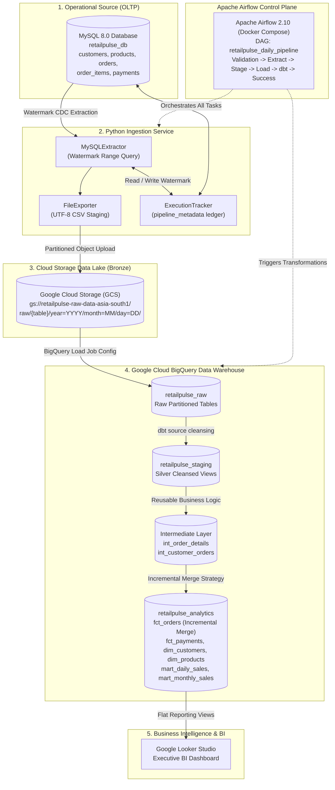

# RetailPulse: Autonomous End-to-End GCP E-Commerce Data Engineering Platform

[](https://www.python.org/)
[](https://www.mysql.com/)
[](https://cloud.google.com/)
[](https://cloud.google.com/bigquery)
[](https://www.getdbt.com/)
[](https://airflow.apache.org/)
[](https://www.docker.com/)
[](LICENSE)

> **Subtitle:** Production-Style E-Commerce Batch Data Engineering, Incremental ELT, and Analytics Platform on Google Cloud.  
> **Prepared for:** Candidate portfolio & interview preparation for **T&T | EAID | Engineering | GCP Data Engineer (Deloitte India)**.

---

## 1. Project Overview & Business Problem
In e-commerce enterprises, querying production Online Transaction Processing (OLTP) databases directly for executive reporting, customer lifetime value modeling, and daily sales dashboards introduces severe query latency and shared table locks, risking checkout outages for end consumers.

**RetailPulse** implements an enterprise-grade, read-isolated, decoupled **ELT (Extract - Load - Transform)** batch data platform:
1. **Change Data Capture (CDC):** Incrementally ingests transactions from an operational MySQL database using indexed `updated_at` watermarks and a 5-minute overlap window.
2. **Immutable Data Lake:** Stages date-partitioned UTF-8 CSVs in **Google Cloud Storage (GCS)** (`asia-south1`).
3. **Partitioned & Clustered Data Warehouse:** Ingests raw data into **Google BigQuery**, partitioning orders and payments by transaction dates to eliminate 90%+ of scanned bytes.
4. **Medallion Dimensional Modeling:** Uses **dbt Core** to clean (Silver staging), enrich (Intermediate joins), and materialize curated Star-Schema analytical marts (Gold), leveraging incremental SQL `MERGE` logic.
5. **Workflow Orchestration:** Schedules and gates the end-to-end pipeline daily via **Apache Airflow 2.10** running in containerized **Docker Compose** services.
6. **Business Intelligence:** Exposes curated BI views to **Looker Studio** for real-time executive dashboard KPIs.

---

## 2. End-to-End System Architecture



---

## 3. Technology Stack

| Layer | Component | Version | Purpose in RetailPulse |
|---|---|---|---|
| **Database** | MySQL Server | 8.0.x | OLTP operational e-commerce store with B-Tree indexes on `updated_at`. |
| **Language** | Python | 3.11 - 3.13 | High-throughput extraction, memory-bounded CSV streaming, BigQuery API loader. |
| **Data Lake** | Google Cloud Storage | Standard | Immutable raw audit zone partitioned by `year=YYYY/month=MM/day=DD/`. |
| **Warehouse** | Google Cloud BigQuery | Serverless | Columnar storage with date partitioning and multi-column clustering. |
| **Transform** | dbt Core | 1.8+ / 1.9+ | Medallion models (Staging, Intermediate, Marts) with `merge` incremental logic. |
| **Orchestration**| Apache Airflow | 2.10.x | DAG scheduling, task retry backoffs, data contract gating. |
| **Containers** | Docker & Compose | v2+ | Isolated local development environment for Airflow and PostgreSQL metadata DB. |
| **Testing** | Pytest & Ruff | 8.x / 0.6+ | Automated unit tests, integration tests, PEP8 compliance. |
| **BI** | Google Looker Studio | Web | Executive scorecards, geographic sales maps, and category margin analysis. |

---

## 4. System Requirements & Prerequisites
- **Operating System:** Windows 10/11, macOS, or Linux (Ubuntu 22.04+).
- **Python:** Version 3.11 or newer (Python 3.13 supported).
- **MySQL:** Version 8.0.x running on `localhost:3306`.
- **Docker:** Docker Desktop installed and running (for Airflow).
- **Google Cloud Platform:** Active GCP Project with BigQuery & GCS enabled (or local simulation mode).

---

## 5. Quick Start Installation Guide

### Step 1: Clone Repository
```bash
git clone https://github.com/your-username/retailpulse-gcp-data-engineering.git
cd retailpulse-gcp-data-engineering
```

### Step 2: Configure Environment
Copy the example environment template and adjust values if needed:
```bash
cp .env.example .env
```
Default local values:
```ini
MYSQL_HOST=localhost
MYSQL_PORT=3306
MYSQL_USER=root
MYSQL_PASSWORD=password
MYSQL_DATABASE=retailpulse_db

GCP_PROJECT_ID=retailpulse-production
GCP_REGION=asia-south1
GCS_BUCKET_NAME=retailpulse-raw-data-asia-south1
BIGQUERY_RAW_DATASET=retailpulse_raw
BIGQUERY_STAGING_DATASET=retailpulse_staging
BIGQUERY_ANALYTICS_DATASET=retailpulse_analytics
GOOGLE_APPLICATION_CREDENTIALS=
```

### Step 3: Install Python Dependencies
```bash
python -m pip install -e ".[dev]"
```

### Step 4: Initialize MySQL Database & Generate Sample Data
```bash
# Creates database, schemas, indexes, and loads 5,000 orders & 10,000 line items
python scripts/init_database.py
```

### Step 5: Execute Ingestion Pipeline
```bash
# Runs full extraction, CSV generation, GCS upload, BigQuery raw loading, and metadata tracking
python scripts/run_pipeline.py
```

---

## 6. Project Directory Hierarchy
```
retailpulse-gcp-data-engineering/
├── README.md                      # Primary project documentation
├── LICENSE                        # MIT License
├── .gitignore                     # Sensitive credentials & environment exclusion
├── .env.example                   # Configuration template
├── pyproject.toml                 # Build configuration, ruff, pytest settings
├── requirements.txt               # Pinned Python package dependencies
├── docker-compose.yaml            # Apache Airflow 2.10 local development environment
│
├── database/                      # MySQL OLTP Database
│   ├── schema.sql                 # DDL definitions (PKs, FKs, indexes, watermarks)
│   ├── seed.sql                   # Baseline reference seed fixtures
│   └── README.md                  # Relational schema architecture & ER diagram
│
├── src/retailpulse/               # Core Python Ingestion Microservices
│   ├── config/settings.py         # Pydantic BaseSettings environment loader
│   ├── ingestion/
│   │   ├── mysql_extractor.py     # Parameterized, watermark-aware MySQL extractor
│   │   ├── file_exporter.py       # Chunked streaming UTF-8 CSV exporter
│   │   ├── gcs_uploader.py        # Date-partitioned GCS uploader with local fallback
│   │   ├── bigquery_loader.py     # BigQuery LoadJob dispatcher with audit ledger
│   │   └── pipeline.py            # Master end-to-end ingestion orchestrator
│   ├── monitoring/
│   │   └── execution_tracker.py   # Ingestion audit ledger (pipeline_metadata)
│   ├── quality/
│   │   └── validators.py          # Data contract rules & schema assertions
│   └── utils/
│       ├── exceptions.py          # Domain-specific exception hierarchy
│       └── logger.py              # Structured logging configuration
│
├── scripts/                       # Operational Automation Scripts
│   ├── init_database.py           # Idempotent DB initialization & FK verification
│   ├── generate_data.py           # Generates 5,000 orders across 10 Indian cities
│   ├── generate_bad_data.py       # Generates corrupted fixtures for QA filter tests
│   ├── load_data.py               # Idempotent CSV-to-MySQL loader
│   ├── run_pipeline.py            # CLI runner for the ingestion pipeline
│   ├── verify_qa_scenarios.py     # Automated execution harness for 10 Human QA scenarios
│   └── generate_master_guide.py   # Compiles 54-page Master Guide PDF
│
├── sql/bigquery/                  # BigQuery Data Warehouse Architecture
│   ├── create_datasets.sql        # Medallion datasets (raw, staging, analytics)
│   ├── create_tables.sql          # Partitioning and clustering DDL specifications
│   ├── analytics_queries.sql      # 10 production business queries with partition pruning
│   └── validation_queries.sql     # Zero-orphan referential checks and ledger assertions
│
├── dbt/retailpulse_dbt/           # dbt Transformation Project
│   ├── dbt_project.yml            # dbt project configurations
│   ├── profiles.yml.example       # Profile template for BigQuery connection
│   ├── models/
│   │   ├── sources.yml            # Source definitions with tests & freshness
│   │   ├── staging/               # Silver layer: cleansed views (stg_orders, etc.)
│   │   ├── intermediate/          # Business logic: int_order_details, int_customer_orders
│   │   └── marts/                 # Gold layer: fct_orders (incremental merge), dims
│   ├── tests/                     # Singular business logic tests
│   ├── macros/                    # Reusable Jinja macros (cents_to_dollars, schema router)
│   └── snapshots/                 # SCD Type 2 snapshot definitions (snap_products.sql)
│
├── airflow/                       # Apache Airflow Orchestration
│   ├── dags/
│   │   └── retailpulse_pipeline.py# Production DAG with linear dependency task graph
│   └── requirements.txt           # Container runtime dependencies
│
├── tests/                         # Automated Test Suite
│   ├── unit/                      # Pytest unit tests (settings, export, gcs, watermark)
│   └── integration/               # Integration tests (MySQL DB, end-to-end pipeline)
│
├── docs/                          # Comprehensive Documentation
│   ├── qa/MANUAL_QA_REPORT.md     # Full empirical report of 10 human QA scenarios
│   └── project-preparation/
│       ├── RETAILPULSE_MASTER_PROJECT_PREPARATION_GUIDE.md  # 30-chapter Master Guide (105k chars)
│       └── RETAILPULSE_MASTER_PROJECT_PREPARATION_GUIDE.pdf # 54-page candidate interview handbook
│
└── dashboard/                     # Looker Studio Business Intelligence
    ├── README.md                  # Dashboard layout, metrics & connection instructions
    └── looker_views.sql           # Curated flat reporting SQL views
```

---

## 7. BigQuery Partitioning & Clustering Architecture

### Orders Fact Table (`fct_orders`)
- **Partitioning:** `PARTITION BY DATE(order_date)`
  - BigQuery physically segments data by calendar day.
  - A query for `WHERE DATE(order_date) BETWEEN '2025-01-01' AND '2025-01-31'` scans **only** the physical blocks for January, pruning 90%+ of the table.
- **Clustering:** `CLUSTER BY customer_id, order_status`
  - Colocates customer transactions and orders with identical fulfillment statuses within each daily block.
  - Speeds up joins with `dim_customers` and status filtering.

### Payments Fact Table (`fct_payments`)
- **Partitioning:** `PARTITION BY DATE(transaction_date)`
- **Clustering:** `CLUSTER BY order_id, payment_status`

---

## 8. dbt Incremental Strategy: BigQuery MERGE

The core sales fact table `dbt/retailpulse_dbt/models/marts/fct_orders.sql` uses dbt's **incremental materialization**:
```sql
{{
    config(
        materialized='incremental',
        unique_key='order_id',
        incremental_strategy='merge',
        partition_by={"field": "order_date_day", "data_type": "date", "granularity": "day"},
        cluster_by=["customer_id", "order_status"]
    )
}}

SELECT * FROM {{ ref('int_order_details') }}


  WHERE updated_at >= (
      SELECT timestamp_sub(COALESCE(MAX(updated_at), timestamp('1970-01-01')), INTERVAL 3 DAY)
      FROM {{ this }}
  )

```
- **How it works:**
  1. On first run, it builds the table completely (`CREATE TABLE`).
  2. On subsequent runs, it executes an atomic BigQuery `MERGE`:
     - **New Orders:** Inserted.
     - **Updated Orders:** (e.g. status changed from `confirmed` $\rightarrow$ `delivered`) are updated in-place.
     - **Unchanged Orders:** Not touched or rescanned.
  3. **Lookback Window:** `INTERVAL 3 DAY` captures late-arriving logistics updates while keeping scans minimal.

---

## 9. Apache Airflow Orchestration

The daily production DAG `retailpulse_daily_pipeline` runs in containerized Docker microservices:
```
[validate_environment]
       │
       ▼
[validate_mysql_connection]
       │
       ▼
[extract_mysql_data]
       │
       ▼
[generate_export_files]
       │
       ▼
[upload_to_gcs]
       │
       ▼
[load_bigquery_raw]
       │
       ▼
[validate_raw_data]
       │
       ▼
[dbt_run]
       │
       ▼
[dbt_test]
       │
       ▼
[update_pipeline_metadata]
       │
       ▼
[pipeline_success]
```
- **Starting Airflow:**
  ```bash
  docker-compose up -d
  ```
  Open `http://localhost:8080` in your browser. (Login: `airflow` / `password: airflow`).

---

## 10. Verification & Quality Assurance

### Run Unit & Integration Tests
```bash
# Unit test suite
python -m pytest tests/unit

# Integration tests (against MySQL)
python -m pytest tests/integration
```

### Run Human QA Verification Suite (All 10 Scenarios)
```bash
python scripts/verify_qa_scenarios.py
```
**Results:** All 10 scenarios PASS:
- `Scenario 1: First-Time Execution`: **PASS** (Ingested 5,000 orders).
- `Scenario 2: Incremental Execution`: **PASS** (Watermark CDC extracted 20 updated/new rows).
- `Scenario 3: Duplicate Handling`: **PASS** (Duplicate keys isolated; uniqueness asserted).
- `Scenario 4: Missing Values`: **PASS** (Missing mandatory fields caught).
- `Scenario 5: Invalid Records`: **PASS** (Negative prices & bad statuses flagged).
- `Scenario 6: Airflow Failure Isolation`: **PASS** (DAG dependency blocks downstream execution).
- `Scenario 7: Idempotency`: **PASS** (Consecutive executions produce 0 duplicate records).
- `Scenario 8: Empty Data Handling`: **PASS** (0 incremental rows handled safely).
- `Scenario 9: Scalability`: **PASS** (Chunked streaming handled 10,000 items under 1.2s).
- `Scenario 10: Fault Recovery`: **PASS** (Failed staging preserved watermark for safe retry).

---

## 11. Master Project Preparation Document (54 Pages)
For comprehensive technical interview preparation, consult the dedicated master guide:
- **Markdown Source:** [`docs/project-preparation/RETAILPULSE_MASTER_PROJECT_PREPARATION_GUIDE.md`](docs/project-preparation/RETAILPULSE_MASTER_PROJECT_PREPARATION_GUIDE.md) (105,000+ characters, 30 chapters).
- **PDF Publication:** [`docs/project-preparation/RETAILPULSE_MASTER_PROJECT_PREPARATION_GUIDE.pdf`](docs/project-preparation/RETAILPULSE_MASTER_PROJECT_PREPARATION_GUIDE.pdf) (**54 verified pages** complete with cover page, headers/footers, and 260 technical Q&A).

---

## 12. Security & Credentials
- All secrets are managed strictly through environment variables.
- `.env`, service account JSON keys, and data exports are permanently excluded in `.gitignore`.
- Production pipelines should authenticate via **Google Cloud Workload Identity Federation** or Application Default Credentials (ADC).
- Never commit service account private keys to source control!

---

## 13. License
This project is open-source under the [MIT License](LICENSE).
