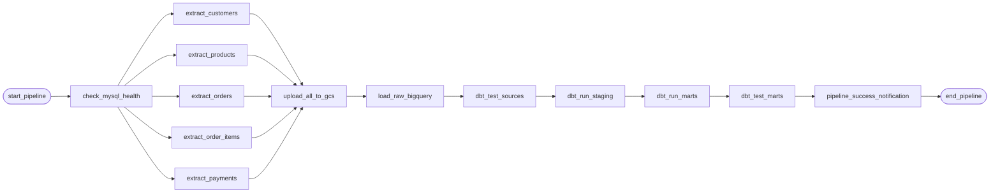

# RetailPulse Architecture & Technical Design Document

## 1. System Overview
**RetailPulse** is an enterprise-grade, end-to-end batch data engineering and analytics platform built with modern cloud-native standards. It simulates a high-scale e-commerce transactional environment, ingesting OLTP data from MySQL, landing raw extracts into Google Cloud Storage, loading into Google BigQuery Bronze storage, transforming through dbt Core across Medallion layers (Bronze -> Silver -> Gold), and orchestrating end-to-end with Apache Airflow.

```mermaid
flowchart TD
    subgraph Source_OLTP ["Source System (OLTP)"]
        mysql[("MySQL 8.0 Database<br/>retailpulse_db")]
        tables["customers, products,<br/>orders, order_items, payments"]
        mysql --- tables
    end

    subgraph Ingestion_Engine ["Python Ingestion Engine"]
        extractor["MySQL Extractor<br/>(Chunked, Watermark Tracking)"]
        exporter["File Exporter<br/>(CSV / Parquet Gzip)"]
        validator["DQ Pre-Landing Validator<br/>(Schema & Integrity Guards)"]
        tracker["Execution Tracker<br/>(Audit Logging & Watermarks)"]
        extractor --> validator --> exporter --> tracker
    end

    subgraph Data_Lake ["Google Cloud Storage"]
        gcs[("GCS Raw Data Lake<br/>gs://retailpulse-lake-landing/")]
        folders["raw/{table}/{YYYY}/{MM}/{DD}/"]
        gcs --- folders
    end

    subgraph Data_Warehouse ["Google BigQuery Medallion Lakehouse"]
        subgraph Bronze ["Bronze Layer (Raw)"]
            bq_raw[("Dataset: retailpulse_raw<br/>External / Native Append-Only")]
        end
        subgraph Silver ["Silver Layer (Staging)"]
            bq_staging[("Dataset: retailpulse_staging<br/>Cleansed Views, Typed Schema")]
        end
        subgraph Gold ["Gold Layer (Marts)"]
            bq_gold[("Dataset: retailpulse_dbt<br/>Star-Schema Dimensions & Facts<br/>Partitioned & Clustered")]
        end
        bq_raw -->|dbt run| bq_staging -->|dbt run| bq_gold
    end

    subgraph Orchestration ["Orchestration & Serving"]
        airflow["Apache Airflow 2.10<br/>(Scheduled DAGs, SLAs, Alerts)"]
        dashboard["Streamlit Analytics Portal / Looker Studio<br/>(Executive BI, Real-time Visuals)"]
    end

    mysql -->|Incremental Extract| extractor
    exporter -->|TLS 1.3 / GCS API| gcs
    gcs -->|Load Job (WRITE_TRUNCATE/APPEND)| bq_raw
    airflow -->|Trigger & Monitor| Ingestion_Engine
    airflow -->|Trigger| Data_Warehouse
    bq_gold -->|SQL Direct Query| dashboard
```

---

## 2. Medallion Architecture Specification

### Bronze Layer (Raw Ingestion)
- **Dataset**: `retailpulse_raw`
- **Tables**: `raw_customers`, `raw_products`, `raw_orders`, `raw_order_items`, `raw_payments`
- **Design Pattern**: Append-only / write-truncate per daily batch landing from GCS extracts. Preserves exact source schema fidelity with zero transformations, including raw timestamp strings. Includes audit columns (`_loaded_at`, `_source_file`, `_batch_id`).

### Silver Layer (Staging & Cleansing)
- **Dataset**: `retailpulse_staging`
- **Models**:
  - `stg_customers`: Lowercases and trims email addresses, formats Indian telephone numbers, standardizes registration timestamps.
  - `stg_products`: Casts price and COGS to numeric standard types, calculates retail markups, categorizes merchandise inventory.
  - `stg_orders`: Standardizes order status strings, handles timezone normalization to UTC.
  - `stg_order_items`: Validates volume quantities, computes line-item total values with discounts.
  - `stg_payments`: Maps payment methods and payment statuses, verifies currency amounts.
- **Intermediate Models** (`intermediate/`):
  - `int_customer_orders`: Enriches customers with historical lifetime order counts, first order date, and latest order timestamp.
  - `int_order_details`: Combines orders with item lines and product metadata to calculate aggregated gross order value.
  - `int_payment_summary`: Aggregates payment settlements per order, identifying fully paid, underpaid, or refund transactions.

### Gold Layer (Dimensional Analytics Marts)
- **Dataset**: `retailpulse_dbt`
- **Models**:
  - `dim_customers`: SCD Type 1 customer dimension with customer lifetime metrics and segment classification (`VIP`, `Regular`, `New`).
  - `dim_products`: Merchandising dimension with pricing tiers, supplier cost metrics, and active product flags.
  - `fct_orders`: **Partitioned by `order_date` (MONTH) and clustered by `customer_id` and `order_status`**. Implemented with dbt incremental strategy (`merge`) and a 3-day lookback window (`order_date >= DATE_SUB(current_date(), INTERVAL 3 DAY)`).
  - `fct_payments`: Partitioned by `payment_date` (MONTH) and clustered by `payment_method`.
  - `mart_daily_sales`: Pre-aggregated executive sales reporting grain per day, category, and state.
  - `mart_monthly_sales`: High-level executive KPI rollups (MoM growth, gross revenue, order volume).
  - `mart_customer_analytics`: RFM (Recency, Frequency, Monetary) segmentation data model.

---

## 3. High-Watermark Incremental Extraction Logic

Incremental extraction isolates changed data from MySQL using updated timestamps:

$$\text{Watermark} = \max(\text{updated\_at}) \quad \text{from target table}$$

1. The pipeline queries `pipeline_metadata` for the last recorded watermark timestamp `T_last` for table `tbl`.
2. Extract query executes:
   ```sql
   SELECT * FROM orders 
   WHERE updated_at > :last_watermark 
   ORDER BY updated_at ASC 
   LIMIT 10000;
   ```
3. Records are exported and landed in GCS.
4. On successful load completion, `pipeline_metadata` records the new watermark `T_new = max(updated_at)` in an ACID atomic transaction.

---

## 4. Airflow DAG Orchestration

The pipeline DAG (`retailpulse_pipeline.py`) follows strict dependency ordering:



---

## 5. Security & Governance
- **Zero Hardcoded Credentials**: Configured via Pydantic `SettingsConfigDict` reading from environment variables (`.env`).
- **GCP Least Privilege**: Dedicated service account (`retailpulse-pipeline-runner`) restricted to `storage.objectAdmin`, `bigquery.dataEditor`, and `bigquery.jobUser`.
- **Audit Trails**: Source table `pipeline_metadata` and BigQuery metadata columns record batch ID, record count, execution status, and latency.

