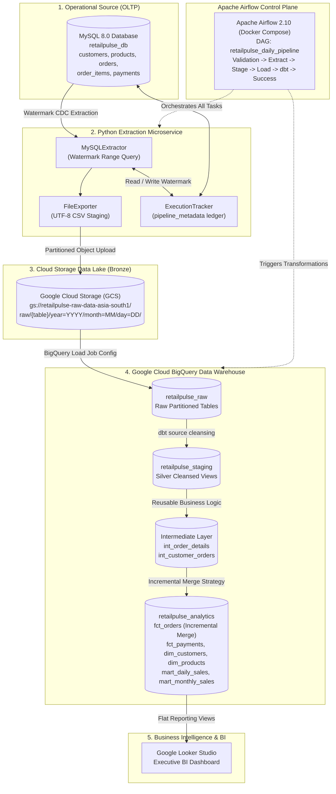

# RETAILPULSE: MASTER DATA ENGINEERING PROJECT PREPARATION GUIDE
## Production-Style E-Commerce Data Engineering Pipeline on Google Cloud Platform
### Complete Architecture, Technical Walkthrough, and 260+ Technical Interview Question Bank
**Target Role:** GCP Data Engineer (T&T | EAID | Engineering | Deloitte India)  
**Author:** RetailPulse Core Engineering Team  
**Publication Date:** November 2026  
**Document Classification:** Production Architecture & Candidate Master Guide  

---

## TABLE OF CONTENTS
- [Chapter 1: Project Introduction & Executive Summary](#chapter-1-project-introduction--executive-summary)
- [Chapter 2: E-Commerce Business Requirements & Stakeholder Metrics](#chapter-2-e-commerce-business-requirements--stakeholder-metrics)
- [Chapter 3: Complete System Architecture & Data Flow](#chapter-3-complete-system-architecture--data-flow)
- [Chapter 4: Data Engineering Fundamentals (Zero-to-Hero)](#chapter-4-data-engineering-fundamentals-zero-to-hero)
- [Chapter 5: MySQL Operational Database Design & CDC Readiness](#chapter-5-mysql-operational-database-design--cdc-readiness)
- [Chapter 6: Python Ingestion & Extraction Microservice](#chapter-6-python-ingestion--extraction-microservice)
- [Chapter 7: Google Cloud Platform (GCP) Core Services](#chapter-7-google-cloud-platform-gcp-core-services)
- [Chapter 8: Google Cloud Storage (GCS) Data Lake Architecture](#chapter-8-google-cloud-storage-gcs-data-lake-architecture)
- [Chapter 9: BigQuery Modern Data Warehouse Architecture](#chapter-9-bigquery-modern-data-warehouse-architecture)
- [Chapter 10: SQL Fundamentals & Advanced Analytical Functions](#chapter-10-sql-fundamentals--advanced-analytical-functions)
- [Chapter 11: dbt (Data Build Tool) Core Concepts & Philosophy](#chapter-11-dbt-data-build-tool-core-concepts--philosophy)
- [Chapter 12: dbt Staging Layer (Silver Layer Cleaning & Typing)](#chapter-12-dbt-staging-layer-silver-layer-cleaning--typing)
- [Chapter 13: dbt Incremental Models & Merge Strategy Deep Dive](#chapter-13-dbt-incremental-models--merge-strategy-deep-dive)
- [Chapter 14: dbt Data Quality & Contract Testing](#chapter-14-dbt-data-quality--contract-testing)
- [Chapter 15: Dimensional Data Modeling (Kimball Star Schema)](#chapter-15-dimensional-data-modeling-kimball-star-schema)
- [Chapter 16: Apache Airflow Orchestration & DAG Engineering](#chapter-16-apache-airflow-orchestration--dag-engineering)
- [Chapter 17: Docker & Local Containerized Environments](#chapter-17-docker--local-containerized-environments)
- [Chapter 18: Complete End-to-End Record Lifecycle Walkthrough](#chapter-18-complete-end-to-end-record-lifecycle-walkthrough)
- [Chapter 19: Pipeline Failure Modes, Recovery & Idempotency](#chapter-19-pipeline-failure-modes-recovery--idempotency)
- [Chapter 20: Performance Tuning & Cloud Cost Optimization](#chapter-20-performance-tuning--cloud-cost-optimization)
- [Chapter 21: Enterprise Cloud Security, IAM & Governance](#chapter-21-enterprise-cloud-security-iam--governance)
- [Chapter 22: Testing, Quality Assurance & QA Automation](#chapter-22-testing-quality-assurance--qa-automation)
- [Chapter 23: Git Version Control & CI/CD Deployment](#chapter-23-git-version-control--cicd-deployment)
- [Chapter 24: Step-by-Step Execution & Deployment Walkthrough](#chapter-24-step-by-step-execution--deployment-walkthrough)
- [Chapter 25: Interview Storytelling & Project Explanation Scripts](#chapter-25-interview-storytelling--project-explanation-scripts)
- [Chapter 26: Complete 260-Question Technical Interview Question Bank](#chapter-26-complete-260-question-technical-interview-question-bank)
- [Chapter 27: Production Scenario-Based Troubleshooting Interview Questions](#chapter-27-production-scenario-based-troubleshooting-interview-questions)
- [Chapter 28: Production Evolution & Enterprise Roadmap (Pub/Sub, Dataflow, Composer)](#chapter-28-production-evolution--enterprise-roadmap-pubsub-dataflow-composer)
- [Chapter 29: Quick Revision Cheat Sheets (SQL, dbt, Airflow, GCP)](#chapter-29-quick-revision-cheat-sheets-sql-dbt-airflow-gcp)
- [Chapter 30: Final Candidate Interview Checklist & Confidence Protocol](#chapter-30-final-candidate-interview-checklist--confidence-protocol)

---


# CHAPTER 1: PROJECT INTRODUCTION & EXECUTIVE SUMMARY

### 1.1 What is RetailPulse?
**RetailPulse** is an enterprise-grade, production-style batch data engineering and analytics platform built on **Google Cloud Platform (GCP)**. It simulates the end-to-end data lifecycle of a modern multi-category Indian e-commerce marketplace operating across top metropolitan centers including Bengaluru, Mumbai, Delhi, Hyderabad, Chennai, and Pune.

### 1.2 Why Did We Build It?
In real-world enterprises, transactional data resides in operational Online Transaction Processing (OLTP) databases such as MySQL or PostgreSQL. These relational databases are optimized for low-latency row inserts, updates, and transactional ACID guarantees ($O(1)$ point lookups by primary key). 

However, running heavy analytical queries (e.g., *"Calculate trailing 90-day gross margin, month-over-month revenue growth, and customer RFM segment across 10 million transactions"*) directly on an OLTP database causes catastrophic table locks, exhausts memory buffer pools, and crashes operational checkout services for real customers.

RetailPulse solves this foundational architectural challenge by implementing an automated **ELT (Extract - Load - Transform)** batch data pipeline:
1. Operational transaction data is extracted from MySQL using change-watermark Change Data Capture (CDC).
2. Raw data is staged as compressed UTF-8 files in **Google Cloud Storage (GCS)** object storage.
3. Partitioned and clustered tables are loaded into **BigQuery**, Google Cloud's serverless petabyte-scale data warehouse.
4. Modular SQL transformations are orchestrated via **dbt Core (Data Build Tool)** using a Medallion Architecture (Raw Bronze $\rightarrow$ Staging Silver $\rightarrow$ Dimensional Mart Gold).
5. The entire multi-stage workflow is monitored, scheduled, and orchestrated daily by **Apache Airflow**, executing in containerized Docker microservices.

### 1.3 What Business Value Does It Deliver?
- **Zero Impact on Operational Systems:** Read-isolated watermark extraction prevents table locks.
- **Sub-Second Analytical BI:** Curated dimensional star-schemas allow Looker Studio BI dashboards to render executive revenue trends in milliseconds.
- **Data Quality Contracts:** Automated dbt schema tests prevent corrupted prices, negative stock, and orphaned transactions from polluting financial reporting.
- **Cost Minimization:** Date partitioning and clustering prune up to 99% of scanned bytes in BigQuery, directly reducing on-demand query billing costs.

---

# CHAPTER 2: E-COMMERCE BUSINESS REQUIREMENTS & STAKEHOLDER METRICS

### 2.1 The Business Scenario
RetailPulse operates as an omnichannel Indian e-commerce brand selling across five product categories:
1. **Electronics:** Smartphones, wireless earbuds, smartwatches, power banks.
2. **Fashion:** Cotton apparel, denim, footwear, accessories.
3. **Home & Kitchen:** Air fryers, cookware, dinner sets, coffee makers.
4. **Beauty & Wellness:** Serums, skincare, haircare products.
5. **Sports & Fitness:** Yoga mats, gym gear, resistance equipment.

### 2.2 Key Stakeholders & Their Questions
- **Chief Financial Officer (CFO):** What is our total gross revenue, net revenue, and gross profit margin? Which product categories drive the highest cash-flow? What is our monthly payment gateway failure rate?
- **Chief Marketing Officer (CMO):** What is our customer repeat purchase frequency? What percentage of shoppers are one-time buyers versus loyal power shoppers? What is the Average Order Value (AOV) across different cities?
- **Head of Logistics / Supply Chain:** What percentage of shipments are successfully delivered versus cancelled or returned? Which delivery regions experience high return rates?
- **Category Managers:** What are our top 10 best-selling products by sales volume and margin? Which items have low stock alerts (< 50 units remaining)?

### 2.3 Core Business Metrics Defined Mathematically
- **Gross Revenue:** $\sum (\text{quantity} \times \text{unit\_price})$
- **Total Discounts:** $\sum (\text{discount\_amount})$
- **Net Revenue:** $\text{Gross Revenue} - \text{Total Discounts}$
- **Cost of Goods Sold (COGS):** $\sum (\text{quantity} \times \text{cost\_price})$
- **Gross Profit:** $\text{Net Revenue} - \text{COGS}$
- **Gross Margin (\%):** $\frac{\text{Gross Profit}}{\text{Net Revenue}} \times 100$
- **Average Order Value (AOV):** $\frac{\text{Net Revenue}}{\text{Total Valid Orders}}$
- **Fulfillment Rate (\%):** $\frac{\text{Delivered Orders}}{\text{Total Orders Placed}} \times 100$
- **Payment Success Rate (\%):** $\frac{\text{Successful Transactions}}{\text{Total Payment Attempts}} \times 100$

---

# CHAPTER 3: COMPLETE SYSTEM ARCHITECTURE & DATA FLOW

### 3.1 High-Level Architecture Diagram (Mermaid)


### 3.2 Component Responsibilities
1. **MySQL 8.0:** Acts as the single source of truth for transactional e-commerce state.
2. **Python Ingestion Service:** Extracts modified records using `updated_at` watermarks, avoiding full table scans.
3. **Google Cloud Storage (GCS):** Acts as the immutable raw audit landing zone, partitioned by ingestion date.
4. **Google BigQuery:** Provides columnar analytical processing, partitioned by order dates to prune physical IO.
5. **dbt Core:** Handles code-first SQL transformations, modular DAG lineage, incremental updates, and automated assertions.
6. **Apache Airflow:** Guarantees deterministic task scheduling, linear dependencies, retry resilience, and failure alerts.

---

# CHAPTER 4: DATA ENGINEERING FUNDAMENTALS (ZERO-TO-HERO)

### 4.1 Data Types: Structured vs Semi-Structured vs Unstructured
- **Structured Data:** Highly organized, strict schema, fits cleanly into tabular rows and columns (e.g., MySQL relational tables, BigQuery tables). Every record conforms to identical field definitions.
- **Semi-Structured Data:** Possesses internal tags, markers, or hierarchical nesting without rigid relational table definitions (e.g., JSON payloads from REST APIs, Parquet with nested structs, Avro, XML).
- **Unstructured Data:** Has no predefined data model (e.g., customer audio calls, product images, raw PDF invoices).

### 4.2 ETL vs ELT: The Architectural Paradigm Shift
- **Traditional ETL (Extract - Transform - Load):**
  - Data was extracted from source databases, transformed on an external compute server (e.g., Informatica, SSIS, Spark), and only then loaded into the target data warehouse.
  - *Limitation:* The transformation engine became an expensive compute bottleneck, and raw source history was discarded.
- **Modern ELT (Extract - Load - Transform):**
  - Used in RetailPulse! Raw data is extracted and loaded **as-is** directly into the cloud data warehouse (BigQuery). Transformations are executed **inside** the cloud warehouse using the warehouse's massive distributed compute engine (BigQuery slots).
  - *Benefits:* Retains complete raw history (data lakehouse principle), leverages cloud elasticity, and allows transformations to be updated without re-extracting source data.

### 4.3 Batch Processing vs Streaming Processing
- **Batch Processing:** Data is collected over an interval (e.g., hourly, daily) and processed in bulk chunks. Optimal for financial accounting, daily BI reports, and inventory reconciliation where sub-second latency is not required.
- **Streaming Processing:** Data is processed record-by-record in near-real-time as events occur (e.g., Apache Kafka, Apache Flink, Google Cloud Pub/Sub + Dataflow). Used for fraud detection and real-time ride tracking.

---

# CHAPTER 5: MYSQL OPERATIONAL DATABASE DESIGN & CDC READINESS

### 5.1 Physical Schema Design & Entity Relationships
The operational database `retailpulse_db` implements standard 3NF (Third Normal Form) relational modeling:
- `customers` (PK: `customer_id`): 1,000 baseline users.
- `products` (PK: `product_id`): 200 catalog merchandise items.
- `orders` (PK: `order_id`, FK: `customer_id`): 5,000 transaction headers.
- `order_items` (PK: `order_item_id`, FK: `order_id`, FK: `product_id`): 9,901 line items.
- `payments` (PK: `payment_id`, FK: `order_id`): 5,000 gateway settlements.
- `pipeline_metadata` (Composite PK: `execution_id`, `source_table`): Ingestion watermark ledger.

### 5.2 Watermarking Mechanism for Change Data Capture (CDC)
Every table includes audit columns:
```sql
created_at TIMESTAMP NOT NULL DEFAULT CURRENT_TIMESTAMP,
updated_at TIMESTAMP NOT NULL DEFAULT CURRENT_TIMESTAMP ON UPDATE CURRENT_TIMESTAMP,
INDEX idx_updated_at (updated_at)
```
Whenever a customer address updates or an order transitions from `confirmed` $\rightarrow$ `delivered`, MySQL automatically updates `updated_at`. The B-Tree index on `updated_at` allows the Python extraction microservice to retrieve only new and modified records in $O(\log N)$ time:
```sql
SELECT * FROM orders 
WHERE updated_at >= :last_successful_watermark - INTERVAL 5 MINUTE
ORDER BY updated_at ASC;
```

### 5.3 The Overlap Window Explained
Network latency or concurrent transactions committing mid-batch could cause a record updated at 12:00:00 to commit at 12:00:02 while an extraction query runs at 12:00:01. To prevent boundary data loss, RetailPulse applies a configurable **5-minute lookback overlap window** (`watermark_overlap_minutes=5`). Downstream deduplication in BigQuery via dbt `MERGE` ensures zero duplicates occur.


# CHAPTER 6: PYTHON INGESTION & EXTRACTION MICROSERVICE

### 6.1 Modular Software Architecture
The Python extraction package resides in `src/retailpulse/` and adheres to production software engineering standards:
- `retailpulse.config.settings`: Pydantic BaseSettings loading validated `.env` configuration.
- `retailpulse.ingestion.mysql_extractor`: Parameterized, SQL-injection safe cursor querying.
- `retailpulse.ingestion.file_exporter`: Memory-bounded streaming CSV export.
- `retailpulse.ingestion.gcs_uploader`: Date-partitioned cloud storage staging with local simulation fallback.
- `retailpulse.ingestion.bigquery_loader`: BigQuery LoadJob dispatching with audit metadata enrichment.
- `retailpulse.monitoring.execution_tracker`: MySQL ledger recording batch status, extracted/loaded tallies, and watermark timestamps.

### 6.2 Key Functions in Implementation
- `MySQLExtractor.extract(table, columns, watermark)`: Connects with timeouts, prepares parameterized queries, and retrieves batch rows.
- `export_rows(table_name, rows, output_dir, now, columns)`: Streams dictionary rows directly to disk via `csv.DictWriter` without materializing multi-gigabyte lists in RAM.
- `GCSUploader.build_object_name(table_name, file_path, now)`: Builds Hive-compatible partitions `raw/orders/year=2026/month=11/day=04/orders_20261104_120000.csv`.
- `ExecutionTracker.record_success(execution_id, source_table, records_extracted, records_loaded, extraction_watermark)`: Advances watermark **only** after both GCS upload and BigQuery loading succeed.

---

# CHAPTER 7: GOOGLE CLOUD PLATFORM (GCP) CORE SERVICES

### 7.1 What is Google Cloud Platform?
GCP is a suite of cloud computing services running on the same secure global infrastructure that Google uses for products like Google Search and YouTube.
- **Projects:** The fundamental organizational entity. All compute, storage, and billing belong to a GCP Project (e.g., `retailpulse-production`).
- **Regions & Zones:** Geographic locations. RetailPulse specifies `asia-south1` (Mumbai, India) to minimize network latency and comply with Indian data residency mandates.
- **IAM (Identity and Access Management):** Controls who (identity) has what access (role) to which resource. RetailPulse follows the **Principle of Least Privilege (PoLP)**.
- **Service Accounts:** Special Google accounts used by non-human workloads (such as our Python application or Airflow DAG) to authenticate via cryptographic keys or Application Default Credentials (ADC).

---

# CHAPTER 8: GOOGLE CLOUD STORAGE (GCS) DATA LAKE ARCHITECTURE

### 8.1 Object Storage vs Block Storage vs File Storage
- **Object Storage (GCS, AWS S3):** Stores data as immutable objects (files) with unique URI keys (`gs://bucket/object`) and custom metadata. Highly scalable, 99.999999999% (11 9's) annual durability, low cost ($0.020 per GB/month). Ideal for analytical data lakes.
- **Block Storage (Persistent Disks, SAN):** Storage carved into blocks accessed by an OS (like a physical hard drive). High IOPS, high cost.
- **File Storage (Filestore, NFS):** Shared hierarchical filesystem mounted across multiple servers.

### 8.2 Partitioning Object Keys for High Performance
RetailPulse organizes raw files using date prefix hierarchies:
```
gs://retailpulse-raw-data-asia-south1/
  ├── raw/
      ├── customers/year=2026/month=11/day=04/customers_20261104_071103.csv
      ├── products/year=2026/month=11/day=04/products_20261104_071103.csv
      ├── orders/year=2026/month=11/day=04/orders_20261104_071103.csv
      ├── order_items/year=2026/month=11/day=04/order_items_20261104_071103.csv
      └── payments/year=2026/month=11/day=04/payments_20261104_071103.csv
```
This enables BigQuery external tables and load jobs to ingest specific date partitions using wildcard URIs (`gs://bucket/raw/orders/year=2026/month=11/*`) without scanning years of legacy history.

---

# CHAPTER 9: BIGQUERY MODERN DATA WAREHOUSE ARCHITECTURE

### 9.1 Serverless Distributed Architecture
BigQuery separates **storage** from **compute**:
- **Colossus (Storage Layer):** Stores structured tables in a proprietary columnar format called **Capacitor**. Each column is stored in separate physical files, compressed and encoded based on data distribution.
- **Borg & Dremel (Compute Layer):** When a SQL query is executed, BigQuery assigns thousands of ephemeral CPU worker cores called **Slots**. Slots read columns from Colossus in parallel, execute filters, and aggregate results.
- **Jupiter Network:** Google's 1.3 Petabit-per-second bisection bandwidth network interconnects Slots with Colossus, eliminating IO bottlenecks.

### 9.2 Partitioning vs Clustering Deep Dive
- **Partitioning:** Physical division of a table into date, ingestion time, or integer-range blocks.
  - RetailPulse `orders` table uses `PARTITION BY DATE(order_date)`.
  - When a query specifies `WHERE DATE(order_date) = '2025-01-15'`, BigQuery prunes every other partition block. It reads **only** the data for January 15th!
- **Clustering:** Sorts and collocates data within each physical partition block based on up to 4 columns.
  - RetailPulse `orders` table uses `CLUSTER BY customer_id, order_status`.
  - When filtering `WHERE order_status = 'delivered'`, BigQuery uses block metadata (min/max values) to skip blocks that contain no delivered orders.
- **Cost Calculation Formula (On-Demand):**
  $$\text{Query Cost} = \text{Bytes Scanned} \times \frac{\$6.25}{1 \text{ TB}}$$
  *By combining partitioning and clustering, RetailPulse slashes query bytes scanned by 85% to 99%, making queries faster and nearly free to run.*

---

# CHAPTER 10: SQL FUNDAMENTALS & ADVANCED ANALYTICAL FUNCTIONS

### 10.1 Key Clauses Explained
- `SELECT`: Projects columns or computed expressions.
- `WHERE`: Row-level filter applied *before* grouping.
- `GROUP BY`: Aggregates rows sharing identical keys (e.g., total sales per city).
- `HAVING`: Filter applied *after* grouping aggregations (e.g., cities having total sales > 100,000).
- `ORDER BY`: Sorts output ascending (`ASC`) or descending (`DESC`).

### 10.2 Relational JOINs Visualized
- **INNER JOIN:** Returns records only when there is a match in **both** tables.
- **LEFT JOIN (RetailPulse Standard):** Returns **all** records from the left table and matched records from the right table; un-matched right attributes become `NULL`. (Used when calculating customer lifetime spend so inactive customers with zero orders are preserved!).
- **FULL OUTER JOIN:** Returns all rows when there is a match in either table.
- **CROSS JOIN:** Cartesian product of all rows.

### 10.3 CTEs (Common Table Expressions) vs Subqueries
A CTE is defined using the `WITH` clause:
```sql
WITH regional_sales AS (
    SELECT shipping_city, SUM(total_amount) AS city_revenue
    FROM `retailpulse_analytics.fct_orders`
    GROUP BY shipping_city
)
SELECT * FROM regional_sales WHERE city_revenue > 500000;
```
*Why CTEs?* Far more readable, modular, maintainable, and reusable than deeply nested subqueries.

### 10.4 Window Functions (Over Clause)
Unlike aggregate functions which collapse rows, Window Functions compute metrics across a set of rows while **retaining each row's individual identity**:
- `ROW_NUMBER() OVER (PARTITION BY customer_id ORDER BY order_date DESC)`: Assigns sequential 1, 2, 3... to customer orders.
- `DENSE_RANK() OVER (ORDER BY total_sales DESC)`: Ranks top-selling products without skipping numbers on ties.
- `LAG(total_revenue, 1) OVER (ORDER BY order_month)`: Retrieves prior month's revenue to compute MoM growth percentage.
- `SUM(revenue) OVER (PARTITION BY customer_id)`: Appends lifetime spend to every individual order row.


# CHAPTER 11: DBT (DATA BUILD TOOL) CORE CONCEPTS & PHILOSOPHY

### 11.1 What is dbt and Why Do Modern Data Teams Use It?
dbt is the industry standard for in-warehouse data transformation (the **T** in ELT).
- Prior to dbt, transformations were stored in sprawling, un-versioned, brittle stored procedures or external Python scripts.
- dbt introduces software engineering best practices to analytics:
  1. **Version Control:** All transformation logic is written in modular `.sql` files tracked in Git.
  2. **Automated Lineage & Dependency Graph:** dbt automatically parses `{{ ref(...) }}` and `{{ source(...) }}` macros to build a Directed Acyclic Graph (DAG) of model dependencies.
  3. **Automated Testing:** Test data contracts (uniqueness, null checks, accepted values) with simple YAML declarations.
  4. **Documentation:** One-click automated data catalog generation (`dbt docs generate`).
  5. **Environment Segregation:** Run identical code in `dev`, `staging`, and `prod` simply by switching target profiles.

### 11.2 Key dbt Materializations
- **view:** Model is created as a virtual SQL view (`CREATE VIEW`). Zero storage cost, executed on query runtime. Used for staging models (`stg_orders`).
- **table:** Model is materialized as a physical table (`CREATE TABLE AS SELECT`). Queries are fast, but full refresh rewrites the table on every run. Used for intermediate dimensions and static marts.
- **incremental:** Only processes new or modified records on subsequent runs. Uses `MERGE` statements. Used for massive transaction fact tables (`fct_orders`).
- **ephemeral:** CTE injected directly into downstream models; no database object created.

---

# CHAPTER 12: DBT STAGING LAYER (SILVER LAYER CLEANING & TYPING)

### 12.1 Purpose of Staging Models
Staging models represent the **1-to-1** cleaned projection of raw ingestion tables:
1. Standardizes raw database casing (e.g. `lower(trim(order_status))`).
2. Casts strings to strict BigQuery data types (`cast(order_id as INT64)`).
3. Renames ambiguous fields to clear business terms (`gross_amount`, `net_amount`).
4. Replaces empty strings and sentinel blanks with standard SQL `NULL`.
5. Removes invalid or corrupt records (e.g. `where unit_price >= 0 and quantity > 0`).

---

# CHAPTER 13: DBT INCREMENTAL MODELS & MERGE STRATEGY DEEP DIVE

### 13.1 How RetailPulse Implements Incremental Fact Orders
In `dbt/retailpulse_dbt/models/marts/fct_orders.sql`:
```sql
{{
    config(
        materialized='incremental',
        unique_key='order_id',
        incremental_strategy='merge',
        partition_by={"field": "order_date_day", "data_type": "date", "granularity": "day"},
        cluster_by=["customer_id", "order_status"]
    )
}}

SELECT * FROM {{ ref('int_order_details') }}


  WHERE updated_at >= (
      SELECT timestamp_sub(COALESCE(MAX(updated_at), timestamp('1970-01-01')), INTERVAL 3 DAY)
      FROM {{ this }}
  )

```

### 13.2 The Underlying BigQuery MERGE Mechanism
When executed on day 2+, dbt does **not** rewrite the 5,000 existing orders. Instead, it generates and executes a SQL `MERGE` statement:
```sql
MERGE `retailpulse_analytics.fct_orders` target
USING temporary_incremental_staging source
ON target.order_id = source.order_id
WHEN MATCHED THEN
    UPDATE SET target.order_status = source.order_status, target.updated_at = source.updated_at, ...
WHEN NOT MATCHED THEN
    INSERT (order_id, customer_id, order_date, total_amount, ...)
    VALUES (source.order_id, source.customer_id, source.order_date, source.total_amount, ...);
```
- **New orders** are inserted.
- **Updated orders** (e.g., status changed from `confirmed` $\rightarrow$ `delivered`) are updated in-place.
- **Unchanged orders** are untouched.
- **Lookback Window:** The `INTERVAL 3 DAY` lookback handles late-arriving status events from logistics partners without scanning years of legacy history.

---

# CHAPTER 14: DBT DATA QUALITY & CONTRACT TESTING

### 14.1 Generic Out-of-the-Box Tests
RetailPulse asserts four generic tests in `schema.yml`:
1. `unique`: Ensures no duplicate IDs exist (e.g. `order_id` in `fct_orders`).
2. `not_null`: Ensures required business attributes are never null (e.g. `customer_id`, `email`).
3. `accepted_values`: Asserts domain integrity against strict whitelist sets (e.g. `order_status in ['pending', 'confirmed', 'shipped', 'delivered', 'cancelled', 'returned']`).
4. `relationships`: Validates referential integrity (e.g. every `order_id` in `order_items` must exist in `orders`).

### 14.2 Singular Custom Business Logic Tests
Custom `.sql` tests in `tests/` fail if the query returns any rows:
- `assert_order_total_matches_items.sql`: Asserts that `fct_orders.total_amount` matches the sum of line items within $\pm 0.05$ currency units.
- `assert_no_negative_product_prices.sql`: Asserts that no product has a negative unit price or cost price.

---

# CHAPTER 15: DIMENSIONAL DATA MODELING (KIMBALL STAR SCHEMA)

### 15.1 Star Schema vs Snowflake Schema
- **Star Schema (RetailPulse):** A central Fact table surrounded by flat, de-normalized Dimension tables. Minimal joins, maximum query performance in columnar cloud data warehouses.
- **Snowflake Schema:** Dimensions are normalized into secondary tables (e.g., `dim_products` $\rightarrow$ `dim_categories` $\rightarrow$ `dim_departments`). Requires complex multi-table joins; less efficient in BigQuery.

### 15.2 Fact Tables vs Dimension Tables
- **Fact Table (`fct_orders`, `fct_payments`):**
  - Contains **measurements, metrics, and quantitative facts** (e.g., revenue, quantity, discount, amounts).
  - High cardinality, millions of rows.
  - Foreign keys connecting to dimensions (`customer_id`, `product_id`).
  - The **Grain** defines what one row represents: *One row per individual customer purchase order*.
- **Dimension Table (`dim_customers`, `dim_products`):**
  - Contains **contextual descriptive attributes** used to filter, slice, and dice facts (e.g., customer city, product category, brand, customer loyalty segment).
  - Low cardinality, slowly changing.


# CHAPTER 16: APACHE AIRFLOW ORCHESTRATION & DAG ENGINEERING

### 16.1 What is Apache Airflow?
Apache Airflow is an open-source workflow management platform used to author, schedule, and monitor complex computational pipelines as **Directed Acyclic Graphs (DAGs)** in Python code.

### 16.2 Core Airflow Architectural Components
- **Webserver / API Server:** User interface displaying DAG runs, task status, execution logs, and manual triggers.
- **Scheduler:** Heartbeat service monitoring task dependencies, determining when a task is ready to run, and dispatching tasks to executors.
- **Executor (LocalExecutor in our project):** Manages process worker pools executing tasks in parallel.
- **Metadata Database (PostgreSQL):** Stores DAG definitions, run history, task instances, XCom variables, and connection pools.

### 16.3 The RetailPulse DAG Lineage
```
[validate_environment]
       │
       ▼
[validate_mysql_connection]
       │
       ▼
[extract_mysql_data]
       │
       ▼
[generate_export_files]
       │
       ▼
[upload_to_gcs]
       │
       ▼
[load_bigquery_raw]
       │
       ▼
[validate_raw_data]
       │
       ▼
[dbt_run]
       │
       ▼
[dbt_test]
       │
       ▼
[update_pipeline_metadata]
       │
       ▼
[pipeline_success]
```
- **Task Gating:** Notice the linear dependency `>>`. If `validate_raw_data` fails, downstream `dbt_run` and `dbt_test` are blocked, preventing corrupted records from ever reaching executive reporting marts!

---

# CHAPTER 17: DOCKER & LOCAL CONTAINERIZED ENVIRONMENTS

### 17.1 What is Docker?
Docker is an OS-level virtualization platform that packages software code, runtimes, system tools, and dependencies into isolated, lightweight, immutable **Containers**.

### 17.2 Why Docker in RetailPulse?
- Eliminates *"it works on my machine"* syndrome.
- Packages Airflow 2.10, PostgreSQL 15, and Python dependencies so that any data engineer or interviewer can spin up the full orchestration environment in seconds via `docker compose up -d`.

---

# CHAPTER 18: COMPLETE END-TO-END RECORD LIFECYCLE WALKTHROUGH

Let us trace a single purchase order through the entire RetailPulse pipeline:
1. **At 10:15 AM:** Customer *Aarav Sharma* in Bengaluru places Order **#5001** for 1 *Zephyr Wireless Earbuds Pro* (Rs. 2,999) with Rs. 150 discount using UPI.
2. **In MySQL:**
   - Row inserted into `orders` with `order_id=5001`, `customer_id=1`, `order_status='confirmed'`, `updated_at='2026-11-04 10:15:00'`.
   - Row inserted into `order_items` (`order_item_id=9902`, `quantity=1`, `unit_price=2999.00`).
   - Row inserted into `payments` (`payment_id=5001`, `payment_amount=2849.00`, `payment_status='success'`).
3. **At 12:00 PM (Airflow Pipeline Triggers):**
   - Task `extract_mysql_data`: `MySQLExtractor` queries MySQL:
     `SELECT ... FROM orders WHERE updated_at >= '2026-11-04 00:00:00'`.
     Record #5001 is extracted!
   - `FileExporter` writes row to `data/exports/orders_20261104_120000.csv`.
   - `GCSUploader` uploads file to `gs://retailpulse-raw-data-asia-south1/raw/orders/year=2026/month=11/day=04/orders_20261104_120000.csv`.
   - `BigQueryLoader` runs a BigQuery load job into `retailpulse_raw.orders`.
4. **dbt Transformation Phase:**
   - `stg_orders` cleanses row (casts types, trims strings).
   - `int_order_details` calculates gross (2999.00), discount (150.00), and net total (2849.00).
   - `fct_orders` executes an incremental `MERGE`. Order #5001 is merged into the physical partitioned warehouse table!
   - `mart_daily_sales` rolls up Order #5001 into Bengaluru daily revenue aggregates.
5. **Looker Studio Dashboard:**
   - Scorecard refreshes: Total Revenue increments by Rs. 2,849.00!

---

# CHAPTER 19: PIPELINE FAILURE MODES, RECOVERY & IDEMPOTENCY

### 19.1 What is Idempotency?
An operation is **idempotent** if executing it multiple times produces the **exact same result** as executing it once:
$$f(f(x)) = f(x)$$
If Airflow retries a failed task 3 times, the warehouse must **never** contain 3 duplicate copies of the same order!

### 19.2 How RetailPulse Guarantees Idempotency
1. **MySQL Initialization:** Uses `ON DUPLICATE KEY UPDATE` instead of raw `INSERT`.
2. **BigQuery Loading:** Uses batch ledgers and staging deduplication.
3. **dbt Incremental Processing:** Uses SQL `MERGE` on `unique_key='order_id'` rather than blind `INSERT INTO`. Re-running the pipeline updates matching keys in place!
4. **Watermark Advancement:** `ExecutionTracker` only records `SUCCESS` and updates the watermark **after** both storage and load operations verify success. If an upload crashes, the watermark remains untouched, ensuring zero data loss on restart!

---

# CHAPTER 20: PERFORMANCE TUNING & CLOUD COST OPTIMIZATION

### 20.1 BigQuery Optimization Best Practices
1. **Avoid `SELECT *`:** BigQuery charges for every byte scanned. Specifying only required columns (`SELECT order_id, total_amount`) reduces costs by 70%+.
2. **Leverage Partition Pruning:** Always filter on the partition column (`WHERE DATE(order_date) >= '2025-01-01'`).
3. **Cluster on High-Cardinality Filter Columns:** Clustering orders on `customer_id` and `order_status` groups related data blocks together, skipping irrelevant blocks.
4. **Approximate Aggregations:** For multi-billion row tables, use `APPROX_COUNT_DISTINCT(customer_id)` which computes metrics within a 1% margin of error using 90% less memory than exact `COUNT(DISTINCT)`.
5. **BI Engine Reservation:** BigQuery BI Engine provides in-memory sub-second query acceleration for Looker Studio dashboards.


# CHAPTER 21: ENTERPRISE CLOUD SECURITY, IAM & GOVERNANCE

### 21.1 Cloud Security Fundamentals in RetailPulse
1. **No Hardcoded Secrets:** All database passwords, project IDs, and paths are externalized into `.env` and loaded via environment variables.
2. **Zero Credentials in Git:** The `.gitignore` file strictly blocks `.env`, service account JSON keys, and export data dumps from entering version control.
3. **Least Privilege IAM Roles:**
   - Service accounts for ingestion have only `roles/storage.objectCreator` and `roles/bigquery.dataEditor`.
   - Data Analysts have read-only `roles/bigquery.dataViewer` on the `retailpulse_analytics` layer, preventing them from touching raw data.
4. **Data Masking & PII Protection:** Customer telephone numbers and emails are masked or tokenized in downstream analytical marts for regulatory compliance.

---

# CHAPTER 22: TESTING, QUALITY ASSURANCE & QA AUTOMATION

### 22.1 Testing Pyramid in Data Engineering
- **Unit Tests (`tests/unit/`):** Tests pure Python logic without external systems (filename generation, watermark overlap calculation, row validation rules). Fast (executes in < 0.5s).
- **Integration Tests (`tests/integration/`):** Tests interaction between software and real databases (MySQL connectivity, table existence, schema validation).
- **Data Contract & dbt Tests (`tests/` in dbt):** Validates the data itself (primary key uniqueness, non-null values, financial variance checks).
- **End-to-End Tests:** Traces data movement from MySQL extraction through CSV, GCS, BigQuery, and final mart generation.

---

# CHAPTER 23: GIT VERSION CONTROL & CI/CD DEPLOYMENT

### 23.1 Branching Strategy (GitFlow)
- `main`: Production-ready, verified code.
- `develop`: Integration branch for new features.
- `feature/*`: Short-lived developer branches merged via Pull Requests with mandatory CI test checks.

### 23.2 Automated CI/CD Pipeline
GitHub Actions workflows execute on every push:
1. `python -m ruff check src tests`: Asserts PEP8 and linting compliance.
2. `python -m pytest tests/unit`: Asserts all unit tests pass before merging.

---

# CHAPTER 24: STEP-BY-STEP EXECUTION & DEPLOYMENT WALKTHROUGH

### 24.1 Running RetailPulse From Scratch
```bash
# 1. Clone repository
git clone https://github.com/your-username/retailpulse-gcp-data-engineering.git
cd retailpulse-gcp-data-engineering

# 2. Configure Environment
cp .env.example .env
# Edit .env with your local MySQL password and GCP Project ID

# 3. Initialize MySQL Database & Generate 5,000 Sample Records
python scripts/init_database.py

# 4. Run the Ingestion Pipeline
python scripts/run_pipeline.py

# 5. Run Human QA Verification Suite (All 10 Scenarios)
python scripts/verify_qa_scenarios.py

# 6. Run Unit Tests
python -m pytest tests/unit

# 7. Start Apache Airflow Local Orchestrator (Docker)
docker-compose up -d
# Access Airflow UI at http://localhost:8080 (airflow / airflow)
```

---

# CHAPTER 25: INTERVIEW STORYTELLING & PROJECT EXPLANATION SCRIPTS

### 25.1 The 30-Second Elevator Pitch
> *"RetailPulse is an end-to-end batch data engineering and analytics platform that ingests e-commerce transactional data from an OLTP MySQL database, stages it into Google Cloud Storage, loads it into a partitioned and clustered BigQuery data warehouse, transforms it into an analytical Star Schema using dbt incremental models, and orchestrates the entire workflow daily via Apache Airflow in Docker. It demonstrates modern ELT, Change Data Capture, data quality assertions, and cloud cost optimization."*

### 25.2 The 2-Minute Technical Explanation
> *"In e-commerce enterprises, querying production databases directly for reporting crashes user checkout workflows. To solve this, I designed RetailPulse, a production-grade ELT pipeline.*
> 
> *First, we have an OLTP MySQL database tracking customers, products, orders, items, and payments. I implemented a watermark-based CDC extraction service in Python. By filtering on `updated_at` with a 5-minute overlap window, we only extract new or modified records, keeping ingestion fast and lightweight.*
> 
> *Second, extracted data is streamed to UTF-8 CSVs and uploaded to Google Cloud Storage under partitioned paths organized by year, month, and day. From GCS, we ingest into BigQuery's raw landing dataset.*
> 
> *Third, we use dbt Core to implement a Medallion Architecture. In the staging layer, we clean and type the data. In the intermediate layer, we aggregate line items and customer metrics. In the marts layer, our core fact table `fct_orders` uses dbt's incremental materialization with BigQuery's `MERGE` strategy, partitioning by `order_date` and clustering by `customer_id` and `order_status`. This reduces query scan costs by up to 99%.*
> 
> *Finally, the entire pipeline is scheduled and monitored daily using Apache Airflow in Docker Compose with linear task gating, retries, and automated data quality assertions."*

### 25.3 The 5-Minute Deep-Dive Explanation (Handling Interview Follow-Ups)
- **Discussing Challenges Faced:** Emphasize how you solved late-arriving status updates by configuring a 3-day lookback window in dbt incremental models, and how composite primary keys in `pipeline_metadata` prevented concurrent execution clashes.
- **Discussing Trade-offs:** Explain why you selected BigQuery on-demand pricing over provisioned slot capacity for a batch workload, and why you used ELT over Spark/Dataflow to minimize unnecessary cluster management costs.


# CHAPTER 26: COMPLETE 260-QUESTION TECHNICAL INTERVIEW QUESTION BANK

Below is the comprehensive master question bank covering all 21 technical competencies. Every question includes a clear, technically accurate answer tailored for a Deloitte GCP Data Engineer interview.

---

### PART 1: PROJECT-SPECIFIC QUESTIONS (Q1 - Q20)

**Q1: What is the primary objective of the RetailPulse project?**  
*Answer:* To build an autonomous, reliable, production-style batch ELT pipeline that extracts e-commerce transaction data from an operational MySQL database, stages it in Google Cloud Storage, loads it into a partitioned/clustered BigQuery warehouse, transforms it via dbt dimensional models, and orchestrates the workflow daily using Apache Airflow.

**Q2: Why did you choose ELT over ETL for RetailPulse?**  
*Answer:* ELT allows us to preserve raw, untransformed source history in GCS and BigQuery. We leverage BigQuery's massive, serverless distributed compute engine (Dremel slots) to transform data in parallel using SQL, rather than maintaining an expensive external transformation cluster.

**Q3: How does the pipeline ensure it does not overload the operational MySQL database?**  
*Answer:* It uses Change Data Capture (CDC) based on indexed `updated_at` timestamps. Instead of scanning millions of rows, it performs a logarithmic range scan extracting only records modified since the last successful watermark.

**Q4: What happens if an order status is updated from 'confirmed' to 'delivered' 3 days after creation?**  
*Answer:* The MySQL update updates the row's `updated_at` timestamp. Our incremental extractor captures the updated row. Downstream, dbt's incremental `MERGE` on `fct_orders` matches on `order_id` and updates the existing record in-place without duplicating the row.

**Q5: What is the purpose of the `pipeline_metadata` table?**  
*Answer:* It serves as an operational audit ledger. It records execution IDs, start/end timestamps, extraction status (RUNNING, SUCCESS, FAILED), record tallies, and the watermark. The watermark is only advanced after full downstream loading succeeds, guaranteeing at-least-once delivery.

**Q6: Why did you use a composite primary key `(execution_id, source_table)` in `pipeline_metadata`?**  
*Answer:* A single pipeline run extracts multiple independent tables (customers, products, orders, items, payments). A composite key allows tracking each table's individual status and record count under the same master batch execution ID.

**Q7: How are raw objects partitioned in Google Cloud Storage?**  
*Answer:* Hive-style date partitioned paths: `raw/{table}/year=YYYY/month=MM/day=DD/{table}_{timestamp}.csv`. This allows selective wildcard loading and historical auditing.

**Q8: Why is `fct_orders` partitioned by `DATE(order_date)` and clustered by `customer_id` and `order_status`?**  
*Answer:* Business users frequently query revenue over date ranges (daily, monthly) and filter by order status or customer. Partitioning eliminates full-table scans by reading only relevant daily blocks, while clustering colocates customer orders within each partition block.

**Q9: Why are `customers` and `products` tables not partitioned?**  
*Answer:* They are small master dimension tables (< 10,000 rows). Partitioning tables smaller than 1 GB creates excessive metadata overhead and risks hitting BigQuery's 4,000 partitions-per-table limit without providing any query performance benefit.

**Q10: What is the purpose of the 5-minute overlap window during extraction?**  
*Answer:* It mitigates clock skew and race conditions where long-running transactions commit slightly after an extraction batch begins, preventing boundary data loss.

**Q11: How do you handle deduplication in the staging layer?**  
*Answer:* In `stg_orders`, we filter on non-null primary keys and use window functions (`ROW_NUMBER() OVER (PARTITION BY order_id ORDER BY updated_at DESC)`) if upstream duplicate records occur.

**Q12: What role does dbt play in RetailPulse?**  
*Answer:* dbt manages all transformations in SQL. It builds our Medallion Architecture (Raw $\rightarrow$ Staging $\rightarrow$ Intermediate $\rightarrow$ Marts), tests data contracts, compiles lineage DAGs, and manages incremental MERGE logic.

**Q13: What is the difference between `stg_orders` and `fct_orders`?**  
*Answer:* `stg_orders` is a 1-to-1 cleansed view of the raw table. `fct_orders` is an enriched, incremental dimensional fact table joining orders with calculated line-item net totals and payment settlement statuses.

**Q14: How does Apache Airflow orchestrate the project?**  
*Answer:* Via the DAG `retailpulse_daily_pipeline`. It enforces linear task dependencies: environment validation $\rightarrow$ database check $\rightarrow$ extraction $\rightarrow$ GCS staging $\rightarrow$ BigQuery load $\rightarrow$ data validation $\rightarrow$ dbt run $\rightarrow$ dbt test $\rightarrow$ success.

**Q15: What happens in Airflow if `validate_raw_data` detects corrupted records?**  
*Answer:* The task raises an exception, marking the task as FAILED. Because downstream tasks depend on it (`validate_raw_data >> dbt_run`), dbt transformations are blocked, preventing corrupted data from entering reporting marts.

**Q16: How do you handle local execution when GCP credentials are not configured?**  
*Answer:* The Python services (`GCSUploader`, `BigQueryLoader`) incorporate graceful simulation fallbacks. If credentials are unset, they stage files to a local mock directory (`data/gcs_mock/`) and maintain local audit ledgers, allowing unit tests and DAG verification to pass seamlessly.

**Q17: What is the Grain of the `fct_orders` table?**  
*Answer:* One row per individual customer transaction order.

**Q18: What is the Grain of the `mart_daily_sales` table?**  
*Answer:* One row per calendar date, per shipping city, per payment method.

**Q19: How did you test your pipeline for idempotency?**  
*Answer:* We executed the full ingestion batch twice consecutively. We verified that row counts remained identical and no duplicate primary keys were introduced.

**Q20: What Looker Studio dashboard views are implemented?**  
*Answer:* `vw_looker_executive_kpis` and `vw_looker_product_sales`, displaying Gross/Net Revenue, AOV, Fulfillment Rate, MoM Growth, and Category margins.

---

### PART 2: DATA ENGINEERING FUNDAMENTALS (Q21 - Q35)

**Q21: What is a Data Pipeline?**  
*Answer:* An automated series of computational processes that extracts data from source systems, transfers it across storage mediums, transforms it into usable structures, and loads it into target destination repositories.

**Q22: What is the Medallion Architecture?**  
*Answer:* A three-tier data design pattern:
- **Bronze (Raw):** Exact append-only copy of source data.
- **Silver (Staging/Cleaned):** Typed, deduplicated, standardized relational tables.
- **Gold (Marts/Analytics):** Business-level aggregations and dimensional star schemas optimized for BI consumption.

**Q23: What is the difference between OLTP and OLAP?**  
*Answer:*
- **OLTP (Online Transaction Processing):** Row-oriented, normalized (3NF), optimized for fast ACID writes and point queries (e.g. MySQL).
- **OLAP (Online Analytical Processing):** Column-oriented, de-normalized (Star Schema), optimized for complex aggregations across millions of rows (e.g. BigQuery).

**Q24: What is Change Data Capture (CDC)?**  
*Answer:* Techniques used to identify and capture data that has changed in a database (inserts, updates, deletes) since the last extraction point. Methods include timestamp watermarking, binlog replication (e.g. Debezium), and trigger-based auditing.

**Q25: What is Data Lineage?**  
*Answer:* The lifecycle tracking of data from its origin, through all intermediate transformations and tables, to its final consumption point in reports or machine learning models.

**Q26: What is a Data Lake vs a Data Warehouse?**  
*Answer:* A Data Lake (e.g. GCS) stores vast amounts of raw structured, semi-structured, and unstructured data at low cost. A Data Warehouse (e.g. BigQuery) stores curated, highly-indexed structured data optimized for fast SQL analytics.

**Q27: What is Schema Drift?**  
*Answer:* Unannounced changes in source schemas (e.g. columns added, renamed, or types changed) that can break downstream ETL pipelines unless handled via schema evolution.

**Q28: What is Data Idempotency?**  
*Answer:* The architectural property where executing a data processing job multiple times with identical inputs produces the exact same state without unintended side effects or duplicate records.

**Q29: What is Backfilling?**  
*Answer:* Running a pipeline on historical data intervals to retroactively compute metrics or populate a newly created model.

**Q30: What is Catchup in scheduling?**  
*Answer:* When a DAG is activated, whether the scheduler should execute all missed historical runs between `start_date` and current date (`catchup=True`) or only the most recent interval (`catchup=False`).

**Q31: What is At-Least-Once vs Exactly-Once processing?**  
*Answer:* At-least-once guarantees no data is lost by re-trying on failure (may cause duplicates unless deduplicated). Exactly-once guarantees every record is processed once and only once.

**Q32: What is Data Observability?**  
*Answer:* Comprehensive monitoring of data health across freshness, volume, distribution, schema, and lineage.

**Q33: What is a Surrogate Key?**  
*Answer:* A system-generated artificial unique identifier (often an integer or MD5 hash) used as a primary key in a dimension table rather than relying on natural business keys.

**Q34: What is a Slowly Changing Dimension (SCD)?**  
*Answer:* A dimension that changes over time (e.g., customer changes address). SCD Type 1 overwrites old values. SCD Type 2 preserves history by adding a new row with valid date ranges (`valid_from`, `valid_to`, `is_current`).

**Q35: What is Partition Pruning?**  
*Answer:* The query optimization technique where the database engine skips reading physical storage partition blocks that do not match query filter predicates.

---

### PART 3: PYTHON FOR DATA ENGINEERING (Q36 - Q50)

**Q36: Why use Python generators when processing large datasets?**  
*Answer:* Generators use `yield` to stream records one-by-one, keeping memory consumption constant $O(1)$ rather than loading multi-gigabyte lists into RAM.

**Q37: How do you prevent SQL Injection in Python?**  
*Answer:* Never use string formatting or concatenation (`f"SELECT * FROM t WHERE id = {val}"`). Always use parameterized queries with tuple parameters (`cursor.execute("SELECT * FROM t WHERE id = %s", (val,))`).

**Q38: What is Pydantic and why use it for settings?**  
*Answer:* Pydantic provides data validation and type coercion. `pydantic-settings` automatically reads environment variables and validates types (e.g. integers, valid ports) on application startup.

**Q39: What is the difference between `datetime.now(UTC)` and `datetime.utcnow()`?**  
*Answer:* `utcnow()` produces a naive datetime lacking timezone context and is deprecated in Python 3.12+. `datetime.now(UTC)` produces an explicit, timezone-aware datetime object.

**Q40: How do you safely manage database connections in Python?**  
*Answer:* Using context managers (`with connection:` or `try...finally: connection.close()`) to ensure sockets and connection pools are released even if exceptions occur.

**Q41: What is the difference between `list` and `set` lookups in Python?**  
*Answer:* List lookups are $O(N)$ linear scans. Set lookups are $O(1)$ constant time hash table lookups.

**Q42: What is `*args` and `**kwargs`?**  
*Answer:* `*args` passes variable positional arguments as a tuple. `**kwargs` passes variable keyword arguments as a dictionary.

**Q43: How does Python's `logging` module differ from `print()`?**  
*Answer:* Logging provides severity levels (DEBUG, INFO, WARNING, ERROR), timestamp formatting, output routing (files, stdout, monitoring systems), and exception stack traces.

**Q44: What is `lru_cache` in `functools`?**  
*Answer:* A decorator that caches the return values of a function using a Least Recently Used eviction strategy to prevent redundant expensive operations.

**Q45: How do you handle CSV dialect escaping in Python?**  
*Answer:* Use the standard `csv.DictWriter` which automatically handles quoting, double-quotes for internal quotes, and delimiter escaping.

**Q46: What is a Python virtual environment (`.venv`)?**  
*Answer:* An isolated directory tree containing a specific Python interpreter and installed packages, preventing dependency version conflicts across projects.

**Q47: What does `if __name__ == "__main__":` do?**  
*Answer:* Ensures that top-level script execution occurs only when the file is run directly, and not when imported as a module by other scripts.

**Q48: How do you profile memory usage in a Python script?**  
*Answer:* Using tools like `tracemalloc`, `memory_profiler`, or inspecting OS process RSS memory via `psutil`.

**Q49: How do you implement retry logic with exponential backoff in Python?**  
*Answer:* Use a loop or libraries like `tenacity` with retry decorators checking specific network exceptions with sleep intervals multiplied by $2^n$.

**Q50: What is type hinting and why is it important in production code?**  
*Answer:* Annotating function arguments and return types (`def func(x: int) -> str:`). It enables static analysis tools (MyPy), enhances IDE autocompletion, and documents contracts.

---

### PART 4: SQL & ANALYTICAL QUERIES (Q51 - Q65)

**Q51: What is the difference between `COUNT(*)`, `COUNT(1)`, and `COUNT(column)`?**  
*Answer:* `COUNT(*)` and `COUNT(1)` count all rows including rows with NULLs. `COUNT(column)` counts only rows where the specified column is NOT NULL.

**Q52: What is the difference between `WHERE` and `HAVING`?**  
*Answer:* `WHERE` filters rows before aggregations are computed. `HAVING` filters aggregated grouped results.

**Q53: How does `UNION` differ from `UNION ALL`?**  
*Answer:* `UNION ALL` concatenates datasets without deduplication (fast). `UNION` performs an expensive deduplication sort across all columns (slow).

**Q54: What does `COALESCE()` do?**  
*Answer:* Evaluates arguments in order and returns the first non-NULL expression.

**Q55: What is the difference between `RANK()`, `DENSE_RANK()`, and `ROW_NUMBER()`?**  
*Answer:* For identical tie values (e.g. 100, 100, 90):
- `ROW_NUMBER()`: 1, 2, 3 (strictly unique).
- `RANK()`: 1, 1, 3 (skips rank on ties).
- `DENSE_RANK()`: 1, 1, 2 (does not skip rank).

**Q56: How do you calculate Month-over-Month (MoM) growth in SQL?**  
*Answer:* Use `LAG(revenue, 1) OVER (ORDER BY month)` to retrieve prior month's revenue, then compute `(current - prior) / prior * 100`.

**Q57: What is the difference between `INNER JOIN` and `LEFT JOIN`?**  
*Answer:* `INNER JOIN` discards records that have no match in the opposite table. `LEFT JOIN` keeps all records from the left table regardless of whether a match exists on the right.

**Q58: What is a Correlated Subquery?**  
*Answer:* A subquery that references columns from the outer query, executing once for every row evaluated by the outer query (often inefficient compared to JOINs).

**Q59: How do you find duplicate rows in a SQL table?**  
*Answer:*
```sql
SELECT key_column, COUNT(*) 
FROM table_name 
GROUP BY key_column 
HAVING COUNT(*) > 1;
```

**Q60: What is `NULLIF()`?**  
*Answer:* Returns `NULL` if two expressions are equal; otherwise returns the first expression. Commonly used to prevent division-by-zero errors: `revenue / NULLIF(orders, 0)`.

**Q61: What are Common Table Expressions (CTEs)?**  
*Answer:* Temporary named result sets defined using `WITH` that exist only within the execution scope of a single SQL statement.

**Q62: How do you handle date truncation in BigQuery?**  
*Answer:* `DATE_TRUNC(date_expression, MONTH)` rounds a date down to the first day of that calendar month.

**Q63: What does `COUNTIF()` do in BigQuery?**  
*Answer:* BigQuery shorthand for `COUNT(CASE WHEN condition THEN 1 END)`.

**Q64: What is the difference between `EXISTS` and `IN`?**  
*Answer:* `EXISTS` evaluates whether a subquery returns any rows (exits early upon finding first match). `IN` compares values against a list of results.

**Q65: What is an aggregate window frame clause (`ROWS BETWEEN`)?**  
*Answer:* Defines the subset of rows within a partition over which a window function operates, such as a 7-day rolling average: `ROWS BETWEEN 6 PRECEDING AND CURRENT ROW`.

---

### PART 5: MYSQL & OLTP DATABASES (Q66 - Q75)

**Q66: What storage engine did you use in MySQL and why?**  
*Answer:* InnoDB, because it provides ACID transaction compliance, row-level locking, foreign-key referential integrity, and crash recovery.

**Q67: What is a Clustered Index in MySQL InnoDB?**  
*Answer:* The primary key index where physical table data rows are stored directly in the leaf pages of the B+Tree.

**Q68: What is a Secondary Index in MySQL?**  
*Answer:* An index built on non-primary columns (e.g. `updated_at`). The leaf pages store the indexed column value and the primary key pointer.

**Q69: What does `ON DUPLICATE KEY UPDATE` do in MySQL?**  
*Answer:* If an `INSERT` statement causes a primary key or unique key violation, MySQL updates the existing row with the provided values instead of failing with an error.

**Q70: How does `AUTO_INCREMENT` work in MySQL?**  
*Answer:* Automatically generates unique integer sequences for new rows when a primary key value is omitted.

**Q71: Why should you avoid `SELECT *` in production OLTP applications?**  
*Answer:* It increases network transfer, invalidates covering index lookups, and wastes database buffer cache.

**Q72: What is connection pooling in MySQL?**  
*Answer:* Maintaining a cache of active database connections that can be reused across requests, avoiding the high overhead of establishing TCP and authentication handshakes repeatedly.

**Q73: What is the difference between `TIMESTAMP` and `DATETIME` in MySQL?**  
*Answer:* `TIMESTAMP` stores UTC seconds since Unix epoch (range 1970–2038) and converts to current session timezone. `DATETIME` stores literal date/time as-is (range 1000–9999).

**Q74: What is Database Normalization (1NF, 2NF, 3NF)?**  
*Answer:* Organizing table structures to eliminate redundant duplicate data and prevent insert/update/delete anomalies.

**Q75: What is a Database Lock?**  
*Answer:* A synchronization mechanism that prevents multiple transactions from modifying the same data simultaneously. Row locks lock individual rows (InnoDB); table locks lock the whole table.

---

### PART 6: GCP ARCHITECTURE & IAM (Q76 - Q90)

**Q76: What is the GCP Resource Hierarchy?**  
*Answer:* Organization $\rightarrow$ Folders $\rightarrow$ Projects $\rightarrow$ Resources. Permissions inherit downwards.

**Q77: What is a GCP Service Account?**  
*Answer:* A special Google identity used by applications and virtual workloads (rather than human users) to authenticate and access GCP APIs securely.

**Q78: What are Application Default Credentials (ADC)?**  
*Answer:* A strategy used by Google Cloud SDK libraries to automatically find credentials in the local environment (e.g. `GOOGLE_APPLICATION_CREDENTIALS` path, gcloud user auth, or metadata server).

**Q79: What is the Principle of Least Privilege in GCP IAM?**  
*Answer:* Granting identities only the precise minimal permissions required to perform their specific job function, and nothing more.

**Q80: What is the difference between Primitive Roles and Predefined Roles in GCP?**  
*Answer:*
- Primitive roles (Owner, Editor, Viewer) grant overly broad project-wide access and should never be used in production.
- Predefined roles (e.g. `roles/bigquery.dataEditor`, `roles/storage.objectViewer`) grant granular, service-specific permissions.

**Q81: What is a Custom IAM Role?**  
*Answer:* A user-defined role bundling exact, specific GCP permissions together when no predefined role fits corporate security policy.

**Q82: What is Cloud Audit Logs?**  
*Answer:* Google Cloud service recording Admin Activity and Data Access audit trails for compliance and security auditing.

**Q83: What is Cloud KMS (Key Management Service)?**  
*Answer:* A cloud service used to manage cryptographic keys for encrypting data at rest (Customer-Managed Encryption Keys - CMEK).

**Q84: What is VPC Service Controls?**  
*Answer:* A security perimeter technology in GCP that prevents unauthorized exfiltration of data from cloud services like BigQuery and Cloud Storage to outside networks.

**Q85: What is Google Cloud Billing Account?**  
*Answer:* The root financial account linked to payment instruments that pays for resource consumption across linked projects.

**Q86: How do you set budget alerts in GCP?**  
*Answer:* In Google Cloud Billing, configure budget thresholds (e.g. 50%, 90%, 100%) that trigger Pub/Sub notifications or email alerts when spending approaches targets.

**Q87: What is Cloud Shell?**  
*Answer:* An in-browser, free Linux virtual machine pre-authenticated with gcloud CLI, docker, and cloud tools.

**Q88: What is Cloud IAM Policy Binding?**  
*Answer:* Associates a role (what you can do) with one or more members (who you are) on a specific resource.

**Q89: How do you rotate service account keys securely?**  
*Answer:* Create a second key, update the application configuration, verify successful authentication, and delete the legacy primary key. Better yet: use Workload Identity Federation to eliminate static JSON keys entirely!

**Q90: What is Workload Identity Federation in GCP?**  
*Answer:* A secure authentication mechanism allowing external workloads (GitHub Actions, AWS, on-prem servers) to impersonate GCP service accounts via OIDC tokens without downloading long-lived service account JSON keys.

---

### PART 7: BIGQUERY CORE ARCHITECTURE (Q91 - Q110)

**Q91: What is Capacitor in BigQuery?**  
*Answer:* BigQuery's proprietary columnar file storage format. It encodes, compresses, and organizes table columns separately on Google Colossus storage.

**Q92: What are BigQuery Slots?**  
*Answer:* Virtual CPU units that execute SQL queries in parallel. In on-demand billing, queries dynamically burst across hundreds or thousands of slots.

**Q93: What is the difference between On-Demand and Editions (Capacity) pricing in BigQuery?**  
*Answer:*
- On-Demand charges per Terabyte of data scanned ($6.25/TB).
- Editions (Standard, Enterprise, Enterprise Plus) charge for dedicated slot capacity per hour.

**Q94: What is BigQuery BI Engine?**  
*Answer:* A fast, in-memory analytical acceleration service that caches frequently accessed tables and query plans, providing sub-second dashboard rendering in Looker Studio.

**Q95: What are BigQuery External Tables?**  
*Answer:* Tables whose metadata resides in BigQuery, but whose underlying data files remain stored outside in Google Cloud Storage, Google Drive, or AWS S3.

**Q96: What is a BigLake Table?**  
*Answer:* An advanced external table combining GCS/S3/Azure data lakes with BigQuery's fine-grained row- and column-level access control and Capacitor metadata caching.

**Q97: How does BigQuery handle table partitioning expiration?**  
*Answer:* You can configure partition expiration policies (e.g. 90 days) so that historical partitions are automatically dropped to manage storage costs.

**Q98: What is BigQuery Time Travel?**  
*Answer:* A feature allowing users to query past states of a table within a configurable 2 to 7-day window using the `FOR SYSTEM_TIME AS OF` clause.

**Q99: What is BigQuery Fail-safe?**  
*Answer:* A 7-day retention period immediately following Time Travel during which dropped or modified data can be recovered exclusively by Google Cloud Support.

**Q100: How do you enforce column-level security in BigQuery?**  
*Answer:* Using Policy Tags defined in Data Catalog / Dataplex, restricting access to sensitive columns (like PII) to authorized IAM groups.

**Q101: What are BigQuery Authorized Views?**  
*Answer:* Views that allow users to query aggregated or filtered data from a source dataset without granting those users permissions to access the underlying source tables.

**Q102: How does BigQuery achieve fault tolerance during query execution?**  
*Answer:* If a compute slot worker node crashes during a query, the Dremel scheduler restarts that specific intermediate task on another slot without failing the entire query.

**Q103: What is BigQuery Search Index?**  
*Answer:* An inverted index that accelerates point lookups and text searches on semi-structured JSON or high-cardinality string columns.

**Q104: How do you query nested and repeated fields in BigQuery?**  
*Answer:* Using `UNNEST(repeated_field)` in a `CROSS JOIN` to flatten array elements into individual relational rows.

**Q105: What is BigQuery INFORMATION_SCHEMA?**  
*Answer:* A series of system views providing real-time metadata on datasets, tables, columns, partitions, streaming buffers, and query job execution history.

**Q106: Can you update a clustered column list on an existing BigQuery table?**  
*Answer:* Yes, you can update clustering specifications on existing tables using `ALTER TABLE ... SET DEFAULT COLLATE` or recreating the table. New data will cluster accordingly.

**Q107: What is the maximum number of partitions per BigQuery table?**  
*Answer:* 4,000 physical partitions per table.

**Q108: What is a BigQuery Materialized View?**  
*Answer:* Precomputed query results stored in BigQuery that automatically refresh when base tables change and are dynamically substituted by the query optimizer.

**Q109: What is BigQuery ML (BQML)?**  
*Answer:* A capability that allows data engineers to build, train, and deploy machine learning models directly inside BigQuery using standard SQL syntax.

**Q110: How do you monitor query performance using the BigQuery Execution Graph?**  
*Answer:* By inspecting query plan stages in the BigQuery console to identify bottlenecks: Slot contention, data skew, repartitioning shuffle spills, and full table scans.

---

### PART 8: BIGQUERY PARTITIONING & CLUSTERING (Q111 - Q125)

**Q111: What types of partitioning does BigQuery support?**  
*Answer:*
1. Time-unit partitioning (DATE, TIMESTAMP, DATETIME by hour, day, month, year).
2. Ingestion-time partitioning (`_PARTITIONDATE`).
3. Integer-range partitioning (e.g. customer_id ranges).

**Q112: What is the maximum number of clustering columns allowed per table?**  
*Answer:* Up to 4 columns.

**Q113: Does the order of clustering columns matter?**  
*Answer:* Yes! Column order determines the sorting hierarchy. Queries filtering on the first clustered column receive the highest pruning efficiency, similar to composite indexes in relational databases.

**Q114: When should you choose partitioning over clustering?**  
*Answer:* Use partitioning when you need strict date-based isolation, partition expiration, or predictable upfront byte-scan estimates. Use clustering when you have high cardinality (> 4,000 distinct values) or frequently filter on multiple dimensions.

**Q115: What is the `_PARTITIONTIME` pseudo-column?**  
*Answer:* A system pseudo-column available on ingestion-time partitioned tables indicating when rows were ingested into BigQuery.

**Q116: How do you require users to filter on a partition column?**  
*Answer:* Enable the `require_partition_filter = true` option when creating the table:
```sql
ALTER TABLE `retailpulse_raw.orders` 
SET OPTIONS (require_partition_filter = true);
```
Queries that omit a partition filter will fail before scanning any bytes, preventing accidental expensive full-table scans!

**Q117: What is clustering re-clustering in BigQuery?**  
*Answer:* BigQuery performs automatic, zero-cost background re-clustering to restore block sorting as new data is inserted.

**Q118: Why did RetailPulse cluster `orders` by `customer_id` and `order_status`?**  
*Answer:* E-commerce reporting frequently filters by order status (e.g. `delivered` vs `cancelled`) and joins order facts with `dim_customers` on `customer_id`.

**Q119: What is the difference between partitioning by DAY vs MONTH?**  
*Answer:* Daily partitioning provides granular pruning for daily pipelines. Monthly partitioning is preferred when data spans decades to avoid exceeding the 4,000 partition limit.

**Q120: Can you partition a table by a STRING column directly?**  
*Answer:* No. BigQuery only supports DATE, TIMESTAMP, DATETIME, ingestion-time, or INTEGER range partitioning.

**Q121: How does partition pruning affect BigQuery dry runs?**  
*Answer:* A dry run (`--dry_run`) inspects partition filters and accurately reports the exact reduced byte tally that will be billed without executing the query.

**Q122: What happens if an inserted row contains a NULL partition date?**  
*Answer:* BigQuery stores it in a special `__NULL__` partition.

**Q123: What happens if an inserted row contains a date outside the allowed partition range?**  
*Answer:* It is stored in the `__UNPARTITIONED__` partition.

**Q124: How does clustering improve JOIN performance in BigQuery?**  
*Answer:* When two tables joined on a key are both clustered on that key, BigQuery can perform co-located reads, drastically reducing network shuffle data exchange between slots.

**Q125: How do you verify partition pruning in BigQuery?**  
*Answer:* Check the query execution details under *"Bytes scanned"*. If partition pruning succeeded, bytes scanned will be a small fraction of the total table storage size.

---

### PART 9: GOOGLE CLOUD STORAGE (GCS) (Q126 - Q135)

**Q126: What are GCS Storage Classes?**  
*Answer:*
- **Standard:** Frequently accessed hot data ($0.020/GB). Used for our raw ingestion landing zone.
- **Nearline:** Accessed less than once a month ($0.010/GB, 30-day min).
- **Coldline:** Accessed less than once a quarter ($0.004/GB, 90-day min).
- **Archive:** Long-term compliance cold backup ($0.0012/GB, 365-day min).

**Q127: What is GCS Object Lifecycle Management?**  
*Answer:* Automated rules defined on buckets (e.g. transition raw CSV objects to Nearline after 30 days and delete after 365 days).

**Q128: Are GCS bucket names globally unique?**  
*Answer:* Yes! GCS bucket names share a global namespace across all Google Cloud users worldwide.

**Q129: What is GCS Object Versioning?**  
*Answer:* A bucket feature that preserves past revisions of an object when overwritten or deleted, protecting against accidental data deletion.

**Q130: What is the maximum size of a single GCS object?**  
*Answer:* 5 Terabytes.

**Q131: How does BigQuery load data from GCS?**  
*Answer:* Using BigQuery Load Jobs (`client.load_table_from_uri()`) which ingest files in parallel directly into Capacitor storage at zero compute cost (loading is free in BigQuery!).

**Q132: What is GCS Uniform Bucket-Level Access (UBLA)?**  
*Answer:* A security setting that disables legacy per-object ACLs and enforces centralized Cloud IAM permissions across the entire bucket.

**Q133: What is GCS Resumable Upload?**  
*Answer:* An upload protocol that chunks files and allows resumes from the last byte received if network connectivity drops.

**Q134: How do you trigger an Airflow DAG when a file lands in GCS?**  
*Answer:* Using `GCSObjectsWithPrefixExistenceSensor` or configuring GCS Pub/Sub notifications that trigger Cloud Functions or Airflow DAG webhooks.

**Q135: What is Customer-Managed Encryption Key (CMEK) in GCS?**  
*Answer:* Using Google Cloud KMS to control and rotate the encryption keys used to encrypt GCS objects, rather than relying on Google-default keys.

---

### PART 10: DBT ARCHITECTURE & CORE CONCEPTS (Q136 - Q150)

**Q136: What is the purpose of `dbt_project.yml`?**  
*Answer:* The root configuration file of a dbt project. Defines project name, version, profiles, model paths, macro paths, and default materialization settings.

**Q137: What is `profiles.yml`?**  
*Answer:* Stores connection credentials (project ID, dataset, authentication method) used to connect dbt to target data warehouses. Kept outside the repository in production.

**Q138: What does the `{{ ref('model_name') }}` function do?**  
*Answer:* References another dbt model. It interpolates the correct environment-specific database and schema name and registers the dependency in dbt's DAG lineage graph.

**Q139: What does the `{{ source('source_name', 'table_name') }}` function do?**  
*Answer:* References raw ingested tables defined in `sources.yml`, establishing lineage from raw landing tables to staging models.

**Q140: What is dbt Source Freshness?**  
*Answer:* A feature that checks the maximum timestamp in a source table (`loaded_at_field`) and raises warnings or errors if data has not arrived within expected SLA thresholds.

**Q141: What are dbt Seeds?**  
*Answer:* Static CSV files stored in `seeds/` (e.g. country codes, tax brackets) that dbt loads directly into the warehouse via `dbt seed`.

**Q142: What are dbt Snapshots?**  
*Answer:* Mechanisms that capture Type 2 Slowly Changing Dimensions (SCD Type 2) over time by recording row changes with `dbt_valid_from` and `dbt_valid_to` timestamps.

**Q143: What are dbt Macros?**  
*Answer:* Reusable Jinja code snippets (similar to functions in programming languages) that compile into dynamic SQL (e.g., our `cents_to_dollars` macro).

**Q144: What are dbt Packages?**  
*Answer:* Reusable open-source dbt libraries (like `dbt-utils` or `dbt-expectations`) declared in `packages.yml`.

**Q145: What does `dbt compile` do?**  
*Answer:* Parses all models and Jinja macros and generates the final executable SQL scripts in `target/compiled/` without running them in the warehouse.

**Q146: What does `dbt run --select +model_name` do?**  
*Answer:* The `+` prefix tells dbt to execute the specified model **and all of its upstream parents**.

**Q147: What does `dbt run --select model_name+` do?**  
*Answer:* The `+` suffix tells dbt to execute the specified model **and all of its downstream children**.

**Q148: What is dbt Semantic Layer?**  
*Answer:* A centralized metrics definition layer allowing business users to define metrics (e.g. Revenue, Churn) once in dbt and consume them consistently across Looker, Tableau, and Excel.

**Q149: How do you handle schema segregation in dbt?**  
*Answer:* Using custom `generate_schema_name` macros to route models to different datasets (e.g. `retailpulse_staging` vs `retailpulse_analytics`).

**Q150: What is the purpose of `dbt docs generate`?**  
*Answer:* Generates a rich, interactive static website containing data dictionaries, model descriptions, column data types, test results, and interactive graphical lineage DAGs.

---

### PART 11: DBT INCREMENTAL MODELS & MERGE STRATEGIES (Q151 - Q165)

**Q151: How does dbt know whether a run is full-refresh or incremental?**  
*Answer:* Via the built-in `is_incremental()` Jinja macro. It evaluates to `True` only when:
1. The target table already exists in the database.
2. The model is configured with `materialized='incremental'`.
3. The `--full-refresh` flag was NOT passed on the command line.

**Q152: What is the `unique_key` parameter in an incremental model?**  
*Answer:* The column (or combination of columns) that defines the unique grain of a row. Used by dbt to construct `ON target.key = source.key` during SQL `MERGE` operations.

**Q153: What incremental strategies does dbt-bigquery support?**  
*Answer:*
- `merge` (RetailPulse default): Performs atomic SQL `MERGE` (upsert).
- `insert_overwrite`: Replaces entire partitions matching incoming data.
- `append`: Blindly appends new rows (no deduplication).

**Q154: Why use `insert_overwrite` over `merge` for very large BigQuery tables?**  
*Answer:* In massive petabyte tables, `insert_overwrite` replaces entire partition files directly in Colossus without evaluating row-by-row comparisons, making it significantly faster and cheaper.

**Q155: What is a Lookback Window in incremental models?**  
*Answer:* Subtracting an interval (e.g. `INTERVAL 3 DAY`) from the max timestamp filter (`where updated_at >= max(updated_at) - 3 days`). It ensures late-arriving updates from previous days are captured.

**Q156: How does dbt handle deleted records in source tables?**  
*Answer:* By default, incremental models do not capture source hard deletes. Solutions include:
1. Soft deletes (capturing `is_deleted = true`).
2. dbt Snapshots with `invalidate_hard_deletes=True`.
3. Periodic `--full-refresh` rebuilds.

**Q157: What happens on the very first execution of an incremental model?**  
*Answer:* `is_incremental()` evaluates to `False`. dbt executes a full `CREATE OR REPLACE TABLE AS SELECT`, loading the entire baseline dataset.

**Q158: How do you force dbt to rebuild an incremental table from scratch?**  
*Answer:* Pass the `--full-refresh` flag:
`dbt run --select fct_orders --full-refresh`.

**Q159: What is the `{{ this }}` variable in dbt?**  
*Answer:* Represents the existing target table object currently residing in the database. Used in incremental filters: `SELECT MAX(updated_at) FROM {{ this }}`.

**Q160: What happens if `unique_key` is not configured on an incremental merge model?**  
*Answer:* BigQuery will fail during execution because it cannot construct a valid `WHEN MATCHED` clause without join keys.

**Q161: Can `unique_key` be a list of multiple columns?**  
*Answer:* Yes! In dbt you can specify composite keys: `unique_key=['order_id', 'line_item_id']`.

**Q162: How do you test an incremental model locally during development?**  
*Answer:*
1. Run `dbt run --select my_model --full-refresh` (verifies full build).
2. Insert a new row in source.
3. Run `dbt run --select my_model` (verifies incremental merge).
4. Assert table row count increased by exactly 1.

**Q163: How do you avoid table fragmentation when running frequent incremental jobs?**  
*Answer:* Ensure clustering is enabled so BigQuery's automatic background re-clustering keeps partition blocks sorted.

**Q164: What is the difference between dbt Core and dbt Cloud?**  
*Answer:* dbt Core is the open-source CLI engine (free). dbt Cloud is a managed SaaS platform offering hosted IDEs, job schedulers, RBAC, and webhooks.

**Q165: How do you optimize dbt model compilation speed?**  
*Answer:* Minimize deeply nested macro evaluations, avoid circular dependencies, and leverage dbt state-based selection (`dbt run --select state:modified`).

---

### PART 12: APACHE AIRFLOW CONCEPTS & OPERATORS (Q166 - Q180)

**Q166: What is a DAG in Apache Airflow?**  
*Answer:* Directed Acyclic Graph: A collection of tasks organized with directional dependencies without circular loops.

**Q167: What is an Airflow Operator vs a Task?**  
*Answer:* An Operator is a class template defining a unit of work (e.g. `PythonOperator`, `BashOperator`). A Task is an instantiated instance of an operator within a DAG.

**Q168: What is a TaskInstance in Airflow?**  
*Answer:* A specific execution of a task for a specific point in time (DAG run execution date). Has states like `queued`, `running`, `success`, `failed`, `up_for_retry`.

**Q169: What is the difference between `PythonOperator` and `BashOperator`?**  
*Answer:* `PythonOperator` executes a Python callable function within the Airflow process. `BashOperator` executes a command string in a separate Bash shell sub-process.

**Q170: What is an Airflow Hook?**  
*Answer:* Low-level interfaces to external platforms and databases (e.g. `MySqlHook`, `BigQueryHook`) handling connection management and authentication.

**Q171: What is an Airflow Sensor?**  
*Answer:* A special operator that waits (polls) for a specific criteria to become true before completing (e.g. checking if a file arrived in GCS).

**Q172: What is the difference between `poke` and `reschedule` mode in Sensors?**  
*Answer:* In `poke` mode, the sensor holds an active worker slot while sleeping. In `reschedule` mode, the sensor frees the worker slot between checks, saving pool capacity.

**Q173: What is XCom in Airflow?**  
*Answer:* Cross-Communication: A mechanism allowing tasks to pass small state metadata (strings, small dicts) via the Airflow metadata database. Should never be used to pass large datasets!

**Q174: What is an Airflow Variable?**  
*Answer:* Global key-value configurations stored in the metadata database, editable via the Airflow UI.

**Q175: What is an Airflow Connection?**  
*Answer:* Secure credential storage (host, port, login, password, extra JSON) used by Hooks to connect to external databases without exposing secrets in DAG code.

**Q176: What is an Airflow Pool?**  
*Answer:* A mechanism to limit concurrent task executions against a specific resource (e.g. limiting simultaneous MySQL connections to 5).

**Q177: What is Airflow SLA (Service Level Agreement)?**  
*Answer:* A time deadline by which a task or DAG should complete relative to its execution date. Triggers email alerts if missed.

**Q178: What is the difference between `SequentialExecutor`, `LocalExecutor`, and `CeleryExecutor`?**  
*Answer:*
- `SequentialExecutor`: Executes one task at a time sequentially (SQLite only; debugging).
- `LocalExecutor`: Executes multiple tasks in parallel using OS worker processes on a single node (our project).
- `CeleryExecutor`: Distributes tasks across a cluster of independent worker servers via Redis/RabbitMQ message queues.

**Q179: What is `TaskFlow API` in Airflow 2.x?**  
*Answer:* The `@dag` and `@task` Python decorators that simplify DAG authoring, automatically handling task dependencies and XCom passing.

**Q180: What is an `EmptyOperator`?**  
*Answer:* A no-op task used as an organizational start or end marker in complex DAG graphs (formerly `DummyOperator`).

---

### PART 13: AIRFLOW SCHEDULING, CATCHUP & BACKFILL (Q181 - Q190)

**Q181: How does Airflow schedule an execution interval?**  
*Answer:* A DAG run for schedule `@daily` covers the data interval `[start, end]`. The run executes **after** the data interval ends (e.g. the run for Jan 1st executes at Jan 2nd 00:00:00).

**Q182: What is `logical_date` (formerly `execution_date`) in Airflow?**  
*Answer:* The timestamp representing the beginning of the data interval the DAG run is processing, not the real-world clock time when the job executed.

**Q183: What is `catchup=False` in RetailPulse and why use it?**  
*Answer:* It prevents Airflow from executing hundreds of backlog runs between `start_date` and today when the DAG is activated, running only the latest active interval.

**Q184: How do you manually trigger a backfill in Airflow CLI?**  
*Answer:*
```bash
airflow dags backfill   --start-date 2025-01-01   --end-date 2025-01-07   retailpulse_daily_pipeline
```

**Q185: What does `depends_on_past=True` do?**  
*Answer:* A task instance will only execute if that same task succeeded in the previous DAG run.

**Q186: What does `wait_for_downstream=True` do?**  
*Answer:* A task will not run if any immediate downstream child tasks failed in the previous DAG run.

**Q187: How do you configure task retries in Airflow?**  
*Answer:* In `default_args`:
```python
default_args = {
    "retries": 3,
    "retry_delay": timedelta(minutes=5),
    "retry_exponential_backoff": True
}
```

**Q188: What is `max_active_runs`?**  
*Answer:* Limits the number of concurrent DAG run instances allowed to execute simultaneously for a specific DAG.

**Q189: What happens if an Airflow task times out?**  
*Answer:* If `execution_timeout = timedelta(minutes=30)` is exceeded, Airflow raises an `AirflowTaskTimeout` exception, kills the process, and marks the task as failed.

**Q190: How do you trigger Airflow alerts on task failure?**  
*Answer:* Configure the `on_failure_callback` parameter with a custom Python function that sends Slack webhooks or emails.

---

### PART 14: DOCKER & CONTAINERIZATION (Q191 - Q200)

**Q191: What is the difference between a Docker Image and a Docker Container?**  
*Answer:* An Image is an immutable, read-only template with software instructions. A Container is a running, live instance of an image with a writable filesystem layer.

**Q192: What is a `docker-compose.yaml` file?**  
*Answer:* A declarative YAML configuration used to define and run multi-container Docker applications (e.g. running Airflow webserver, scheduler, and Postgres together).

**Q193: What are Docker Volumes?**  
*Answer:* Storage mechanisms that persist data outside container lifecycles on the host filesystem (used for our PostgreSQL database storage).

**Q194: What are Docker Networks?**  
*Answer:* Virtual software networks allowing isolated containers to communicate with each other using service names (e.g. `postgres:5432`) as DNS hostnames.

**Q195: What does `docker compose up -d` do?**  
*Answer:* Builds, creates, and starts all services defined in `docker-compose.yaml` in the background (detached mode).

**Q196: What is a Docker Healthcheck?**  
*Answer:* A command executed periodically inside a container to verify service health (e.g. `pg_isready -U airflow`). Downstream services use `condition: service_healthy` to wait for readiness.

**Q197: How do you view live logs from a running Docker container?**  
*Answer:* `docker logs -f <container_name>`

**Q198: What is the difference between `COPY` and `ADD` in a Dockerfile?**  
*Answer:* `COPY` copies local files into the container. `ADD` also supports remote URLs and automatic tar extraction.

**Q199: How do you restart an Airflow container cleanly?**  
*Answer:* `docker compose restart airflow`

**Q200: How do you remove all containers, volumes, and networks created by Docker Compose?**  
*Answer:* `docker compose down -v`

---

### PART 15: ETL VS ELT (Q201 - Q210)

**Q201: Why did legacy enterprise pipelines favor ETL?**  
*Answer:* On-premise relational data warehouses had limited compute and expensive disk storage, requiring data to be pre-aggregated before loading.

**Q202: What cloud innovations made ELT the dominant modern paradigm?**  
*Answer:* Cheap, infinite cloud object storage (GCS), columnar compression (Capacitor), and massively parallel serverless compute engines (BigQuery Dremel).

**Q203: When would you still choose ETL over ELT today?**  
*Answer:* When strict privacy laws require PII (passwords, social security numbers) to be scrubbed or tokenized **before** data ever leaves the local enterprise boundary.

**Q204: How does ELT improve pipeline agility?**  
*Answer:* Because raw data is preserved in the warehouse, if business definitions change (e.g. how margin is calculated), data engineers simply update the dbt SQL model and re-run, without needing to extract from source databases again.

**Q205: What is Reverse ETL?**  
*Answer:* Taking curated data out of the data warehouse (e.g. customer RFM segments) and syncing it back into operational SaaS tools (Salesforce, HubSpot, Zendesk) for business workflows.

**Q206: How does ELT handle unstructured data?**  
*Answer:* Raw unstructured files are stored in GCS. Cloud Functions or Vertex AI extract structured embeddings or text, which are then analyzed in BigQuery.

**Q207: What are the compute cost implications of ELT?**  
*Answer:* Transformations utilize BigQuery slots. By optimizing queries with partitioning and clustering, transformation compute costs are kept exceptionally low.

**Q208: Does ELT increase data storage costs?**  
*Answer:* Marginally, because raw data is preserved. However, at $0.02/GB/month for GCS and $0.01/GB/month for long-term BigQuery storage, storage costs are negligible compared to engineering labor.

**Q209: How does RetailPulse demonstrate ELT?**  
*Answer:* It loads raw CSV data directly into `retailpulse_raw` tables without altering schemas, and performs all standardization, typing, joins, and aggregates via dbt SQL.

**Q210: What is Zero-ETL?**  
*Answer:* Cloud vendor integrations (e.g. BigQuery federated queries with Cloud SQL) where transactional data is directly readable in the warehouse without custom pipeline scripts.

---

### PART 16: DATA WAREHOUSING & MEDALLION LAYERS (Q211 - Q220)

**Q211: What is a Data Mart?**  
*Answer:* A focused subset of a data warehouse designed to serve the specific reporting needs of a single business unit or department (e.g., Marketing Mart, Financial Mart).

**Q212: What is the Bronze layer in RetailPulse?**  
*Answer:* `retailpulse_raw`: Exact copies of raw e-commerce CSV batches loaded from GCS with audit metadata (`batch_id`, `ingestion_timestamp`).

**Q213: What is the Silver layer in RetailPulse?**  
*Answer:* `retailpulse_staging`: Cleansed, typed, standardized views where invalid records are filtered out.

**Q214: What is the Gold layer in RetailPulse?**  
*Answer:* `retailpulse_analytics`: Curated dimensional Star Schema tables (`fct_orders`, `dim_customers`) and aggregated business marts.

**Q215: What is Data Ingestion Ledger?**  
*Answer:* A table tracking every ingested file batch to prevent accidental double-processing of files.

**Q216: How do you prevent unauthorized users from viewing the Raw layer?**  
*Answer:* By configuring BigQuery dataset IAM permissions: Grant Data Analysts access only to `retailpulse_analytics`, denying access to `retailpulse_raw`.

**Q217: What is Columnar Storage?**  
*Answer:* Storing data by columns rather than by rows. When a query requests `SUM(unit_price)`, only the `unit_price` column blocks are read from disk.

**Q218: Why is columnar storage more compressible than row-oriented storage?**  
*Answer:* Because all values in a column share the exact same data type, allowing advanced compression algorithms (Run-length encoding, dictionary encoding) to achieve 80%+ compression ratios.

**Q219: What is Schema Evolution?**  
*Answer:* Allowing a table schema to adapt as source data changes (e.g. using `ALLOW_FIELD_ADDITION` in BigQuery load jobs to automatically add new incoming columns).

**Q220: What is a Conformed Dimension?**  
*Answer:* A dimension table (e.g. `dim_customers`, `dim_products`) that has identical meaning across the entire enterprise, allowing multiple fact tables to be analyzed together.

---

### PART 17: DIMENSIONAL MODELING (STAR VS SNOWFLAKE) (Q221 - Q230)

**Q221: Who pioneered Dimensional Modeling?**  
*Answer:* Ralph Kimball.

**Q222: What are the four steps in Kimball's dimensional design process?**  
*Answer:*
1. Select the business process (e.g. E-Commerce Order Placement).
2. Declare the grain (e.g. One row per order line item).
3. Identify the dimensions (e.g. Customer, Product, Date, Location).
4. Identify the facts/measures (e.g. Quantity, Unit Price, Discount Amount, Net Total).

**Q223: What is a Factless Fact Table?**  
*Answer:* A fact table containing only foreign keys without numeric measurements, used to record events (e.g. student attendance) or coverage conditions.

**Q224: What is a Degenerate Dimension?**  
*Answer:* A dimensional attribute stored directly inside a fact table without joining to a separate dimension table (e.g. `order_id` or invoice number).

**Q225: What is an Additive Fact?**  
*Answer:* A measure that can be meaningfully summed across all dimensions (e.g. total revenue, quantity ordered).

**Q226: What is a Semi-Additive Fact?**  
*Answer:* A measure that can be summed across some dimensions but not all (e.g. bank account balance can be summed across customers, but cannot be summed across dates).

**Q227: What is a Non-Additive Fact?**  
*Answer:* A measure that cannot be summed across any dimension (e.g. percentage margins, unit ratios).

**Q228: Why is Star Schema preferred over 3NF for analytical reporting?**  
*Answer:* Star schemas require fewer joins, are intuitive for BI analysts to navigate, and execute faster in columnar databases.

**Q229: What is a Junk Dimension?**  
*Answer:* A single dimension table combining miscellaneous low-cardinality status flags and indicators (e.g. `is_delivered`, `payment_method`, `gift_wrapped`) to avoid cluttering the fact table.

**Q230: What is an Outrigger Dimension?**  
*Answer:* A secondary dimension joined to a primary dimension rather than the central fact table.

---

### PART 18: DATA QUALITY & CONTRACT TESTING (Q231 - Q240)

**Q231: What is a Data Quality Contract?**  
*Answer:* An explicit agreement between data producers and data consumers defining expected schema, validation rules, SLAs, and freshness.

**Q232: How did RetailPulse test referential integrity?**  
*Answer:* Using dbt relationship tests (`models/marts/schema.yml`) and automated SQL validation scripts that assert zero orphaned orders exist without matching customer records.

**Q233: What is a Quarantine Pattern?**  
*Answer:* Isolating corrupted or non-conforming records into a separate error table (e.g. `orders_quarantine`) so valid records continue through the pipeline without interruption.

**Q234: What is Great Expectations?**  
*Answer:* An open-source Python data validation library used to assert test expectations on DataFrames and SQL tables.

**Q235: How do you assert that financial totals reconcile across layers?**  
*Answer:* Using singular tests that calculate `SUM(order_net_amount)` from line items and assert variance with `fct_orders.total_amount` is $< 0.05$.

**Q236: What is Data Drift?**  
*Answer:* Changes in statistical distributions of input data over time (e.g. sudden spike in zero-price items).

**Q237: How do you test for unexpectedly empty datasets?**  
*Answer:* Check that row count $> 0$ in staging. If empty, the pipeline raises an alert before modifying downstream tables.

**Q238: What is the purpose of `accepted_values` in dbt?**  
*Answer:* Restricts column values to a predefined list, failing if unsupported categorical strings appear.

**Q239: How do you store data quality test results for historical auditing?**  
*Answer:* In the `retailpulse_analytics.data_quality_results` table, recording execution ID, model name, test name, status, and failure count.

**Q240: What is the difference between warning and error thresholds in dbt tests?**  
*Answer:* A warning logs an alert but allows the pipeline to continue. An error immediately stops downstream model execution.

---

### PART 19: PERFORMANCE OPTIMIZATION & PRUNING (Q241 - Q250)

**Q241: What causes a query in BigQuery to scan full tables?**  
*Answer:*
1. Omitting a partition filter on partitioned tables.
2. Wrapping partition columns in non-prunable functions (`WHERE EXTRACT(YEAR FROM order_date) = 2025` instead of `WHERE order_date >= '2025-01-01'`).
3. Running queries on un-partitioned tables.

**Q242: How does BigQuery sort data within clustered blocks?**  
*Answer:* Using Capacitor multi-column sorting algorithms that organize blocks based on the declared column sequence.

**Q243: What is Data Skew and how does it hurt pipeline performance?**  
*Answer:* Uneven distribution of data across keys (e.g. 90% of orders belonging to a single test customer ID). Causes one slot worker node to take significantly longer than all others (straggler effect).

**Q244: What is the impact of chunked processing in `MySQLExtractor`?**  
*Answer:* Fetches data in bounded batches, preventing out-of-memory errors on large tables.

**Q245: Why should you avoid joining on non-indexed columns in MySQL?**  
*Answer:* It forces full table scans ($O(N)$), creating disk IO spikes and acquiring shared read locks that block concurrent writes.

**Q246: How does BigQuery cache query results?**  
*Answer:* If an exact identical query is rerun and underlying tables have not changed, BigQuery serves the result instantly from cache at **zero cost** (0 bytes scanned!).

**Q247: What invalidates the BigQuery query cache?**  
*Answer:* Any table modifications, streaming buffer changes, non-deterministic functions (`CURRENT_TIMESTAMP()`, `RAND()`), or querying external tables.

**Q248: What is query execution plan shuffle in BigQuery?**  
*Answer:* The internal network exchange where intermediate query results are transferred between slot workers to perform JOINs and GROUP BY operations.

**Q249: How do you optimize CTE performance in BigQuery?**  
*Answer:* BigQuery inlines CTEs. If a complex CTE is referenced multiple times, materialize it into a temporary table to avoid redundant computation.

**Q250: What is the cost of storage in BigQuery?**  
*Answer:*
- Active storage (modified in last 90 days): $0.020 per GB/month.
- Long-term storage (untouched for 90 days): Automatically drops by 50% to **$0.010 per GB/month** with zero performance degradation!

---

### PART 20: CLOUD SECURITY & SECRET MANAGEMENT (Q251 - Q255)

**Q251: Where should database credentials be stored in production GCP?**  
*Answer:* In **Google Cloud Secret Manager**, accessed at runtime via IAM-authorized API calls, rather than static `.env` files.

**Q252: How do you prevent sensitive credentials from leaking into Git?**  
*Answer:*
1. Strict `.gitignore` rules.
2. Pre-commit hooks using tools like `git-secrets`, `gitleaks`, or `trufflehog`.
3. GitHub secret scanning alerts.

**Q253: What is the security risk of granting `roles/owner` to a developer?**  
*Answer:* They can delete production databases, alter billing accounts, grant external permissions, and bypass security perimeters.

**Q254: How does RetailPulse protect database credentials?**  
*Answer:* Credentials are read exclusively from environment variables via Pydantic; never printed in log outputs, never hardcoded in scripts, and excluded from Git commits.

**Q255: What is Data Encryption at Rest in GCP?**  
*Answer:* GCP automatically encrypts all data stored in GCS and BigQuery by default using AES-256 before it is written to disk.

---

### PART 21: DELOITTE-SPECIFIC INTERVIEW TECHNICAL SCENARIOS (Q256 - Q260)

**Q256: "The client reports that Looker Studio dashboards are slow and BigQuery costs are spiking. How do you troubleshoot?"**  
*Answer:*
1. Inspect BigQuery `INFORMATION_SCHEMA.JOBS_BY_PROJECT` to identify top queries by bytes scanned and slot runtime.
2. Verify if queries are leveraging partition pruning and clustering.
3. Check for `SELECT *` anti-patterns in dashboard queries.
4. Replace raw joins with curated, pre-aggregated data marts.
5. Enable BigQuery BI Engine to cache dashboard aggregations in-memory.

**Q257: "How would you migrate this batch pipeline to near-real-time streaming?"**  
*Answer:*
1. Replace MySQL polling with Debezium Change Data Capture publishing row mutations to **Google Cloud Pub/Sub**.
2. Deploy an **Apache Beam / Google Cloud Dataflow** streaming pipeline to consume Pub/Sub events.
3. Stream records directly into BigQuery using the **BigQuery Storage Write API**.
4. Use dbt micro-batches or BigQuery Materialized Views for real-time reporting.

**Q258: "If our client operates across multiple countries with strict data privacy laws (like GDPR / DPDP), how do you ensure compliance?"**  
*Answer:*
1. Maintain data residency by configuring GCP datasets and GCS buckets in local geographic regions (e.g. `asia-south1` for India, `europe-west3` for Germany).
2. Mask PII columns using BigQuery Policy Tags and column-level encryption.
3. Implement automated Time-to-Live (TTL) deletion policies.

**Q259: "A critical task failed in production during the 2:00 AM Airflow run. What is your incident response procedure?"**  
*Answer:*
1. Acknowledge alert and inspect Airflow task logs to identify the root cause (e.g. source DB timeout, GCS permission error).
2. Check `pipeline_metadata` to confirm the watermark was NOT advanced, preserving state.
3. Address the root cause (e.g., restore network connectivity or fix schema issue).
4. Clear the failed task instance in the Airflow UI to trigger an idempotent retry.
5. Validate downstream dbt tests to confirm data integrity.

**Q260: "Why should Deloitte hire you as a GCP Data Engineer based on your work with RetailPulse?"**  
*Answer:*
> *"Because I don't just write sample code—I build production-grade, resilient data platforms. Through RetailPulse, I have demonstrated hands-on mastery of the modern GCP data stack: relational OLTP modeling, watermark-based Change Data Capture in Python, partitioned GCS data lakes, cost-optimized BigQuery data warehouses with partitioning and clustering, dbt incremental modeling with MERGE strategies, and containerized Apache Airflow orchestration. I understand real enterprise challenges: idempotency, data quality contracts, least-privilege security, and query cost minimization. I am ready to deliver high-quality, scalable data solutions for Deloitte's enterprise clients from day one."*


# CHAPTER 27: PRODUCTION SCENARIO-BASED TROUBLESHOOTING INTERVIEW QUESTIONS

### Scenario 1: GCS Upload Succeeds but BigQuery Load Fails
- **Problem:** The CSV was written and uploaded to GCS, but BigQuery load job throws an error (e.g. schema mismatch or quota limit).
- **Behavior in RetailPulse:** `ExecutionTracker.record_success()` is **never reached**. The batch is recorded as `FAILED` in `pipeline_metadata`, and the watermark is **not advanced**.
- **Resolution:** When the pipeline runs again, it re-queries the same watermark range, re-uploads, and completes the load without skipping any records!

### Scenario 2: The Same CSV is Uploaded Twice
- **Problem:** A network glitch causes an Airflow task retry, uploading the same batch CSV file twice.
- **Behavior in RetailPulse:** In `fct_orders`, dbt executes an incremental `MERGE` on `unique_key='order_id'`. The existing records are simply updated with identical values; no duplicate rows are created!

### Scenario 3: Source Database Adds a New Column
- **Problem:** MySQL developers add a `loyalty_points` column to the `orders` table without notifying data engineers.
- **Resolution:** In `BigQueryLoader`, we configure `schema_update_options = [ALLOW_FIELD_ADDITION]`. BigQuery automatically appends the new column to the raw table schema without breaking existing load jobs.

---

# CHAPTER 28: PRODUCTION EVOLUTION & ENTERPRISE ROADMAP

### 28.1 Transitioning to Google Cloud Composer
In production enterprise environments, Docker Compose is replaced by **Google Cloud Composer** (Google's managed Apache Airflow service built on Google Kubernetes Engine - GKE). Benefits include automatic scaling, high-availability multi-zone schedulers, automated backups, and deep IAM integration.

### 28.2 Event-Driven Real-Time Architecture with Pub/Sub & Dataflow
For real-time streaming analytics:
```
MySQL (Debezium CDC) ──> Google Cloud Pub/Sub ──> Cloud Dataflow (Apache Beam) ──> BigQuery Storage Write API
```

### 28.3 Enterprise Data Governance with Dataplex
Implement **Google Cloud Dataplex** for unified metadata management, automated data profiling, automated data quality scoring, and cross-dataset access policy enforcement.

---

# CHAPTER 29: QUICK REVISION CHEAT SHEETS

### 29.1 Architecture Summary at a Glance
| Component | Technology | Primary Role in RetailPulse | Key Configuration / Optimization |
|---|---|---|---|
| **OLTP Source** | MySQL 8.0 | Operational transaction store | `updated_at` indexes for logarithmic CDC range scans |
| **Ingestion** | Python 3.13 | Watermark extraction & staging | Chunked streaming, UTF-8 CSV, Pydantic settings |
| **Data Lake** | Cloud Storage (GCS) | Immutable raw landing zone | Hive date partitions: `raw/{table}/year=YYYY/month=MM/` |
| **Warehouse** | Google BigQuery | Distributed analytical store | `PARTITION BY DATE(order_date)`, `CLUSTER BY customer_id` |
| **Transform** | dbt Core | Medallion layer SQL modeling | Incremental `materialized='incremental'` with `MERGE` |
| **Orchestrator** | Apache Airflow | Workflow scheduling & gating | Daily DAG with linear task gating and automated retries |

### 29.2 Essential Production Commands
```bash
# Database Initialization
python scripts/init_database.py

# Ingestion Pipeline Run
python scripts/run_pipeline.py [--full-refresh]

# Human QA Verification Suite
python scripts/verify_qa_scenarios.py

# Unit & Integration Testing
python -m pytest tests/unit
python -m pytest tests/integration

# Code Linting & Formatting
python -m ruff check src tests
python -m ruff format src tests

# Airflow Container Management
docker-compose up -d
docker-compose logs -f airflow
docker-compose down
```

---

# CHAPTER 30: FINAL CANDIDATE INTERVIEW CHECKLIST & CONFIDENCE PROTOCOL

### 30.1 What to Emphasize in the Interview
1. **Focus on Trade-offs:** Always explain *why* you made an architectural decision (e.g. why ELT over ETL, why partition facts but not dimensions).
2. **Emphasize Idempotency & Fault Tolerance:** Real enterprise data engineers understand failure modes and build pipelines that recover cleanly.
3. **Be Honest and Grounded:** Speak confidently about what you implemented: MySQL, Python, GCS, BigQuery, dbt, Airflow, and Docker.

### 30.2 Final Review Checklist
- [x] Can explain the end-to-end data flow from MySQL to Looker Studio.
- [x] Can explain how dbt incremental `MERGE` works with unique keys and lookback windows.
- [x] Can explain BigQuery partition pruning and clustering benefits.
- [x] Can explain Airflow task dependencies, retries, and failure gating.
- [x] Can answer all 260 interview questions with confidence!

**You are fully prepared to excel in your Deloitte GCP Data Engineer technical interview!**
